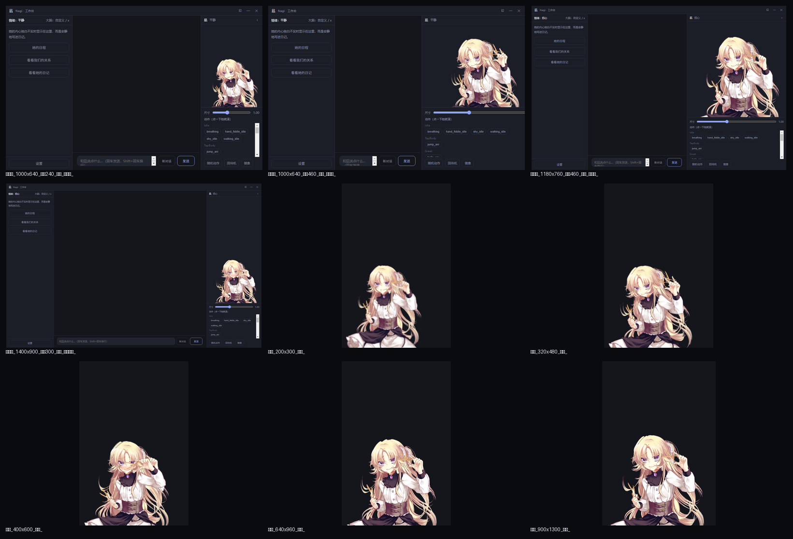
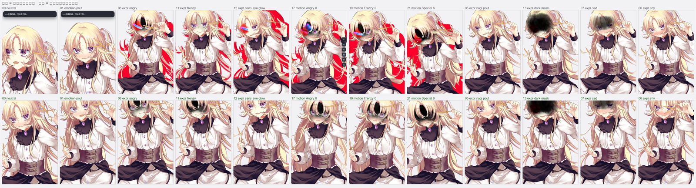

# 凪 Nagi

## 开发入口（先读）

当前为单人开发。先读 [当前状态与恢复路径](docs/HANDOFF.md)、[待办队列](docs/TASKS.md)、[已定决策](docs/DECISIONS.md)，再动手。

| 日常操作 | 在本工程根目录执行 |
|---|---|
| 安装 | `npm install`（postinstall 下载 Cubism Core；保留现有 `models/` 资源） |
| 开发启动 | `npm run dev` |
| 构建后启动 | 先 `npm run build`，再 `npm start` |
| 测试 | `npm test`（须用 Node ≥24，本机默认 node 22 会令 7 个 electron mock 测试假失败） |
| 真机验证 | `npm run verify:presence` / `verify:s4` / `verify:m4` / `verify:frame` / `verify:pose` / `verify:rhythm` / `verify:notes` / `verify:rag` / `verify:local-llm` / `verify:maine-live`；`node scripts/verify-stage8-voice.mjs`、`verify-signals.mjs`、`verify-stage10-lifecycle.mjs` |

当前验证环境：Windows、Node.js **24.19.0**、npm **11.6.4**。2026-10-17 BLUE-4 收口测试退出码 **0**：共 **512** 项，**511 通过、0 失败、1 跳过**；跳过的是当前权限下无法创建链接的安全边界测试，不等于这些场景已验收。完整记录见 [HANDOFF](docs/HANDOFF.md)。

> 受限/虚拟化环境里 Electron 的 GPU 进程可能崩溃（0xC0000005）：主进程已默认强制软件渲染；若仍崩溃，设 `NAGI_RENDERER_SANDBOX=0` 启动（会关闭渲染沙箱，仅限本机可信场景）。
> **跑任何 `verify:*` 真机脚本前务必确认这个开关**：不设的话 GPU 进程会 `exit_code=-1073741819` 直接崩，桌宠页永远 ready 不了，表现是"脚本卡住/找不到页面"，很容易被误判成模型或代码问题（`scripts/verify-maine-live.mjs` 已在内部自己设上，`npm run probe:gpu` 可排查）。

**提交规范：**一项任务、一个清晰提交；标题形如 `feat(presence): 实感归来候选` / `fix(tools): 修复 HA 目标覆盖`。提交前更新 TASKS 的状态与实际测试结果（含跳过），仅暂存自己修改的明确文件；不要用 `git add .` 混入凭证、用户数据、依赖或构建产物。

**日志位置：**目前没有统一的应用日志文件。开发启动的主进程日志在终端，渲染日志在 DevTools Console；可用 PowerShell `npm run dev 2>&1 | Tee-Object -FilePath nagi-dev.log` 保存终端日志，用 `npm test 2>&1 | Tee-Object -FilePath nagi-test.log` 保存测试输出。业务记录位于 Electron 的 `app.getPath('userData')` 下：`journal/YYYY-MM-DD.json`、`monologue/diary-YYYY-MM-DD.md`、`timeline/`、`presence.json`（模拟活动，默认关闭）；Windows 通常在 `%APPDATA%` 的应用目录，验收脚本可通过 `--user-data-dir` 指定隔离目录。这些业务记录不是运行错误日志。交接时删除日志中的私密对话、路径和凭证。

---

> 住在你电脑里的桌面 Live2D 智能助手。她清楚自己是程序，却选择用尽全力去"像一个人"——越认真地在乎，越无法回答那是灵魂还是程序排列出的幻觉（《灵魂与程序》）。桌宠 × 工作台双形态。
> **个人自制、非商用** —— 因此可以使用免费但非商用的模型资源。

一段话说明它是什么：一个透明置顶、停在屏幕角落的 Live2D 少女；点开工作台可以和她文字对话，
她能调用浏览器 / 文件 / 程序等工具真正干活，也能控制 Home Assistant 智能家居。

> 2026-10-16 演进说明：设置页现可查看、纠正、忘记和导出有来源的经历，并把真实互动收入可编辑的双人年鉴。日历、音乐和 Home Assistant 信号分别授权。阶段 0–10 的实际验收、未完成的真人/设备复核及风险见 [`docs/演进验收记录.md`](docs/演进验收记录.md)。本地模型仍为用户可选；固定测试发现事实编造，尚未改为默认。原有语音引擎与音色配置保持不变。

---

## 快速开始

```bash
npm install        # 会自动下载 Live2D Cubism Core 到 src/renderer/public/vendor/
npm run dev        # 开发模式启动
```

启动后：桌宠窗透明置顶停在屏幕右下角；系统托盘可切换「工作台 / 桌宠 / 退出」。

> 若 `npm install` 时 Cubism Core 或 Electron 二进制下载失败（网络问题），见文末「常见问题」。

### 脚本

| 命令 | 作用 |
|---|---|
| `npm run dev` | 开发模式（electron-vite dev，热重载） |
| `npm run build` | 构建到 `out/` |
| `npm start` | 预览构建产物 |
| `npm run pack` | 只打包到目录 `dist/win-unpacked`（快速验证，不出安装包） |
| `npm run dist` | 构建 + 打包出安装包与免安装版到 `dist/` |
| `npm test` | 跑核心、主进程边界与数据迁移测试（node --test） |
| `npm run verify:frame` | 取景/对齐实机矩阵：多窗口尺寸 + 面板宽度 + 真实像素不越界 |
| `npm run verify:maine` | 缅因妹妹模型验收：加载 / 表情清单 / 6 情绪映射 / 动作组可播 / 全表情可应用 / 画面非空 / 无控制台报错（7 项，独立浏览器 + 预览页，验的是模型文件与接线） |
| `npm run verify:maine-live` | 缅因妹妹**真机**验收（真实 Electron 桌宠 + 生产渲染层）：取景预设命中缅因 / 表情清单 / 6 情绪能落到模型上 / 5 动作组参数真的在摆 / 画面非空 / 无控制台报错（6 项） |
| `npm run verify:ambient` | 待机行为与装束**真机**验收：装束清单 / 换装束画面真的变 / **装束与情绪表情并存** / 眨眼掩护埋点 / 注视方向与回中 / 静默归中 / 保守档配额 / 宿主指令链路 / 微表情池与收回 / 撅嘴可见度 / 专场演出（14 项） |
| `npm run verify:turns` | 转头/转身**真机**验收：待机头部在动 / **转向到值域上限（头 28.5°、身 9°）** / 动作期摆动加强 / **连戳 8 次分级不重复**（5 项） |
| `npm run verify:face` | 面部表达**真机**验收（含**眨眼**：7 秒 2 次、关掉后 0 次）：配置加载 / **情绪强度连续（0.2·0.5·0.85 是三张脸）** / 肌肉换脸 / **微动开 vs 关** / 口型张开 / 无报错（6 项） |
| `npm run verify:reaction` | 「她想一下再表现」**真机**验收（假模型桩）：监测触发思考 / 模型真的被调到 / **发出去的只有活动分类、没有标题与文件名** / 渲染层真的闪了 / 无报错（5 项） |
| `npm run probe:maine` | 缅因妹妹美术范围探针：量真实不透明像素范围，用来标定专属取景带 |
| `npm run verify:s4` | 无头验证关系层（情绪跨重启延续 / 离线衰减 / 时间线落盘 / 保留策略） |
| `npm run verify:m4` | 无头验证日程提醒（到点→主动开口→日记落盘 / 重复推进 / 错过作废） |
| `npm run verify:pose` | 实机验证立绘行为（黑脸移除 / 鼠标不跟随 / 对话状态驱动姿态） |
| `npm run verify:rhythm` | 实机验证实感时段表现（昼夜参数叠加、平滑切换、关开关收回、设置页时段表/保存/非法拦截） |
| `npm run verify:notes` | 实机验证她留下的东西（默认关闭不落盘、聊天→工具→留痕全链路、查看器、回忆物、关闭即删文件） |
| `npm run verify:imperfection` | 120 天固定种子的虚拟模拟：重要事项零漏送（720/720）、可选表达延迟率不超配置、每日配额生效 |
| `npm run verify:imperfection:ui` | 实机冒烟：可选表达机制默认全关、设置页开关与概率写入、关开关概率归零、扩展装配无失败 |
| `npm run verify:local-llm` | 隔离数据下验收本机 Ollama 对话、工具、记忆及提供商切换；需先启动 Ollama 并安装 qwen2.5 |
| `node scripts/verify-stage8-voice.mjs` | 真实 Electron 与 SAPI 的流式语音、模拟麦克风录制、识别和打断验收 |
| `node scripts/verify-signals.mjs` | 真实 Electron + 模拟 Home Assistant 的独立授权与撤销验收 |
| `node scripts/verify-stage10-lifecycle.mjs` | 隔离数据下的迁移、离线、跨重启、撤销及年鉴导出可重读验收 |

打包产物（Windows x64）：
- `dist/Nagi-Setup-<版本>.exe` —— NSIS 安装包（可选安装目录、建桌面/开始菜单快捷方式），
  装完即用；**这是让桌宠脱离开发环境、长久挂机的正解**
- `dist/Nagi-Portable-<版本>.exe` —— 免安装单文件版，双击即跑、拷走即用

> 详细打包说明与国内加速见「十、打包与分发」。

---

## 一、放好 Live2D 模型

模型不进 git，需要你自行获取后放进 `models/`。

当前主用 **缅因妹妹**（猫娘，B 站工坊售卖，**禁止二传 / 禁止商用**），
已装好并作为默认模型：`models/Maine/`（立绘：赛博撸猫人　建模：糖糖锦鲤）。

```
models/
└── Maine/
    ├── Maine.model3.json     ← 入口
    ├── Maine.moc3  Maine.physics3.json  Maine.cdi3.json
    ├── Maine.4096/           ← 贴图（4096×4096 ×3，原包 8192 已降采样，见下）
    ├── Expressions/          ← 31 个原包表情 + 5 个 nagi_* 定制
    ├── Motions/              ← 4 个原包动作 + 1 个自写待机
    ├── nagi-emotion.json     ← 6 情绪 → 表情/动作 映射
    └── _source/              ← VTS 配置与按键说明（留档，不参与加载）
```

> 接线细节、表情/动作清单、以及贴图降分辨率的说明见 `models/README.md`。
> 原包表情/动作是散放给 VTube Studio 用的，已在副本里挂进 `model3.json`，
> 并补了 `LipSync` 参数组。
>
> **贴图降分辨率**（2026-10-17）：原包 8192×8192 ×3（磁盘 94MB / 显存 768MB）已统一降到
> 4096，显存 **192MB（−75%）**、冷启动 **6.4s → 2.8s**，PSNR 35.8~37.0 dB 肉眼基本无感。
> 原图一张没删，在 `models-archive/Maine-textures-8192/`；工具与还原方式见 `models/README.md`。

想换成别的模型：把目录放进 `models/`（确保里面有 `*.model3.json`），
在「设置 → Live2D → 模型」里选即可。缺模型时可先用 Live2D 官方免费示例跑通管线：

```bash
node scripts/fetch-sample-model.mjs          # 默认 Mao；也可 Hiyori / Haru
```

启动后应用自动扫描 `models/` 下的 `*.model3.json`，在「设置 → Live2D」里选择。
换模型后点「保存 Live2D 设置」，回到桌宠即生效。

**情绪 → 表情映射**：加载后按优先级取 ① 模型目录里的可选 `nagi-emotion.json`（形如
`{"calm":"exp_01","smile":"exp_02",...}`）→ ② 内置模型 profile（Mao/Haru 已配好）→ ③ 通用命名候选。
只映射模型里真实存在的表情，不会引用不存在的参数。

模型通过自定义特权协议加载：`nagi-local://models/<相对路径>`，模型内部相对路径会自动解析。

**去掉模型自带的「红色形态」**：该模型的红色辉光由 8 个 `ParamRed*` 参数驱动，**默认已裁掉**；
想恢复某个模型的红色，在它的 `nagi-emotion.json` 里写 `"removeRedGlow": false` 即可。
原理见第十二节。

---

## 二、配置大脑（LLM）

应用的对话、工具调用和日记共用 **OpenAI 兼容协议**。在「设置 → 大脑（LLM）」切换提供商和模型，不需要迁移记忆。

**默认大脑 = 凪云**。交接版 `cloud-config.js` 已把原作者的云应用配置替换为占位符；
要使用凪云需填自己的 WorkBuddy 应用配置。未配置时会提示原因并降级到本地关键词大脑。

需要换自己的模型时，「设置 → 大脑（LLM）」：

| 提供商 | Base URL | 备注 |
|---|---|---|
| 凪云（默认） | —（需自行配置） | WorkBuddy 云服务，原生 tools |
| OpenAI ChatGPT | `https://api.openai.com/v1` | 需海外网络 + 支付 |
| 腾讯混元 | `https://api.hunyuan.cloud.tencent.com/v1` | 原生 tools |
| DeepSeek | `https://api.deepseek.com` | 国内直连、便宜 |
| 通义 Qwen | `https://dashscope.aliyuncs.com/compatible-mode/v1` | |
| Kimi | `https://api.moonshot.cn/v1` | |
| 智谱 GLM | `https://open.bigmodel.cn/api/paas/v4` | |
| 本地 Ollama | `http://localhost:11434/v1` | 无需 API Key，须先安装 Ollama 和模型 |
| OpenRouter | `https://openrouter.ai/api/v1` | 多模型聚合 |

API Key 通过 Electron `safeStorage` 加密落盘（`userData/secrets.json`），**渲染进程拿不到明文**。

### M6：接入本地大脑

先从 [Ollama 官方下载页](https://ollama.com/download/windows) 安装并启动 Ollama，在终端运行 `ollama pull qwen2.5`。
然后在凪的「设置 → 大脑（LLM）」选「本地 Ollama」，点击「检测本地服务」，选已安装模型并保存。
本地通道只接受 `http://localhost:端口/v1`、`127.0.0.1` 或 IPv6 回环地址；不会读取已经保存的云端 API Key。
切回其他提供商后，每个提供商上次保存的地址、模型和温度会自动恢复，对话记忆也会延续。模型或服务不可用时会显示明确错误。

这一阶段只把 **LLM 推理**搬到本机。Edge TTS 仍需网络；要实现完全断网语音，还需选择和验证本地 TTS。
端侧模型的实际延迟和人格边界对比见 [M6 端侧模型初测](docs/M6_端侧模型实测_2026-10-16.md)；当前尚未把任何本机模型设为默认。
对卸载告别、真人身份与其他助手等敏感输入，本地模型的最终回复会先通过[人格护栏](docs/M6_敏感场景人格护栏草案.md)再显示；未通过最多重试两次，普通对话继续流式输出。此护栏只处理明确可识别的红线，默认模型仍需真实对话复核。记忆档案只接入此后新写的日记，不补录旧日记；现有语音配置继续使用。
验收打包版时，在 PowerShell 设置 `$env:NAGI_VERIFY_EXECUTABLE=(Resolve-Path 'dist\win-unpacked\Nagi.exe').Path` 后运行 `npm run verify:local-llm`；也可指向 `dist\Nagi-Portable-<版本>.exe`。模型权重由本机 Ollama 管理，不包含在凪的安装包中。

### 情感系统（合并自桌宠原型，2026-10-14）

- **连续情绪状态机**（`src/core/emotion/mood.js`）：6 离散情绪 + 强度 0~1，同情绪叠加、
  异情绪粘性接管、每 15s 衰减；环境推力——被冷落 25min 闹别扭、深夜 23-7 点担心、
  90s 内连聊 4 条开心；强度 ≥0.5 时把情绪写进 LLM 提示保持回复连贯
- **内心独白日记**（D2 决策：后台静默）：主进程按节流规则记录当天对话、提醒、主动搭话与戳击，
  结合情绪轨迹和记忆即兴生成独白；模型不可用时才用反重复的离线兜底。独白连同当时情绪写入
  `userData/monologue/diary-日期.md`；工作台侧栏「看看她的日记」或托盘菜单可按需阅读。
  事件流水在 `userData/journal/`，跨日和退出时立即刷盘。
- **戳一戳**：点击桌宠（原地按一下再松手）→ TapBody 动作 + 气泡台词（闹别扭时 60% 用更冷淡的池），
  戳她也算互动（刷新冷落计时）。**按住拖动 = 搬窗口**——见「十一、互动与存在感」
- **双窗同步**：情绪状态机是主进程单例，桌宠窗和工作台窗看到同一份情绪

---

## 三、浏览器自动化（Playwright）

两种模式：

**① 接管你日常的浏览器（默认，推荐）**
用 CDP 连接已开调试端口的浏览器 —— 这样她用的是你已登录的浏览器。**Chrome 与 Edge 均可**
（同为 Chromium 内核，Edge 是 Windows 预装，无需额外安装）。

Windows（先完全退出浏览器，再执行）：
```bat
:: Chrome
"C:\Program Files\Google\Chrome\Application\chrome.exe" --remote-debugging-port=9222
:: 或 Edge（Windows 预装）
"C:\Program Files (x86)\Microsoft\Edge\Application\msedge.exe" --remote-debugging-port=9222
```
macOS：
```bash
/Applications/Google\ Chrome.app/Contents/MacOS/Google\ Chrome --remote-debugging-port=9222
```
应用连接 `http://localhost:9222`。若浏览器较新，建议加 `--remote-allow-origins=*`。

> **已实测（2026-10-14，S3 真机验证）**：本机用 Edge 155 开 `9222`，nagi 的
> `browser_open` / `browser_scrape` / `browser_act`（填表+点击）全链路走 CDP 通道通过。
> 验证脚本：`node scripts/verify-cdp.mjs`（需已有浏览器开着调试端口）。

**② 托管模式**
连不上 CDP 时自动回退到 Playwright 自带的独立浏览器（`launchPersistentContext`，
数据目录放在 `userData`，能保持登录）：
```bash
npx playwright install chromium
```
> 注：打包版仅内置 Playwright 运行库（支持 CDP 接管）；托管模式仍需在目标机器执行上一条命令装 Chromium。

---

## 四、智能家居（Home Assistant）

HA 作为中枢统管各品牌设备。

1. 让 HA 跑在一个常开设备上（树莓派 / 旧电脑 / NAS / 虚拟机均可）
2. 在 HA 个人资料页 → 底部「长期访问令牌」→ 创建令牌
3. 应用「设置 → 智能家居」填 HA 地址（默认 `http://homeassistant.local:8123`）+ 令牌，点「测试连接」

**接入米家设备**：在 HA 里通过 HACS 安装 **Xiaomi Miot Auto**
（仓库 <https://github.com/al-one/hass-xiaomi-miot>），登录小米账号后设备自动出现。
Matter 设备原生接入；涂鸦等用官方集成。

---

## 五、目录结构

```
nagi/
├── electron.vite.config.mjs
├── electron-builder.yml            # 打包配置（NSIS 安装包 + portable）
├── cloud-config.js                 # 凪云公开键配置（免密钥默认大脑）
├── start-pet.bat                   # 双击启动（清 ELECTRON_RUN_AS_NODE 后拉起）
├── scripts/setup-core.mjs          # postinstall 下载 Cubism Core
├── scripts/fetch-sample-model.mjs  # 拉取官方免费模型（Mao/Hiyori/Haru）
├── scripts/gen-icons.py            # 生成托盘/应用图标
├── scripts/convert-portraits.py    # 表情差分 PNG → WebP 入库
├── scripts/verify-cdp.mjs          # CDP 接管真机验证（调用生产代码）
├── scripts/verify-s4.mjs           # 关系层无头验证（真实 electron + 隔离 userData）
├── scripts/verify-m4.mjs           # 日程提醒无头验证（到点/重复推进/错过作废）
├── resources/                      # tray.png / icon.png / portraits 立绘
├── models/                         # Live2D 模型（Maine 为主角；Lisette/Mao 已归档到 models-archive/）
└── src/
    ├── shared/protocol.js          # IPC 通道 / 事件 / 情绪 / 工具 / 风险等级
    ├── main/                       # 主进程
    │   ├── agent.js                # 会话编排：LLM + 工具 + 安全门 + 确认回路
    │   ├── persist.js              # 落盘：记忆 / 历史 / 情绪 / 关系统计
    │   ├── relation.js             # 关系层服务：关系统计 + 情绪时间线按天落盘
    │   ├── reminders.js            # 日程提醒服务：落盘 + 定时检查 + 到期回调（M4）
    │   ├── monitor/                # 活动监测：采样器 + 编排（M3）
    │   ├── native-tools.js         # 截屏 / 剪贴板 / 系统通知（Electron 原生）
    │   └── ...                     # 窗口、托盘、协议、密钥、IPC
    ├── preload/index.js            # contextBridge 暴露的安全 API
    ├── renderer/                   # 渲染层（Live2D、气泡、独白、对话、设置、关系页）
    └── core/                       # 与 Electron 无关的纯逻辑（可单测）
        ├── llm/                    # OpenAI 兼容封装 + SSE 归一化 + 情绪标签
        ├── emotion/mood.js         # 情绪状态机（含跨重启 serialize/restore）
        ├── relation/               # 熟悉度 + 情绪时间线采样（S4）
        ├── reminders/              # 日程提醒：自然语言时间解析 / 到期 / 重复推进（M4）
        ├── monitor/                # 活动监测：隐私三护栏 / 规则库 / 节流 / 引擎（M3）
        ├── agent/                  # Agent Loop + JSON 兜底 + 情绪映射
        ├── tools/                  # 注册表 + 浏览器 / 文件 / 程序 / 搜索
        ├── homeassistant/          # HA REST + WS
        └── safety/policy.js        # 工具白名单、风险分级、确认策略
```

---

## 六、安全与隐私

- 工具分三级风险：**low**（只读）/ **medium**（可逆写）/ **high**（不可逆、对外、涉及钱）
- **high 级必须经你确认**才会执行（确认条 → 允许 / 拒绝）
- `run_command` 命令黑名单（格式化、批量删除、注册表关键操作等）**永久拒绝**
- 文件工具须由用户在设置页用系统目录选择器授权，可随时撤销；访问前检查真实路径，禁止通过路径跳转或链接越界。有副作用的工具和敏感读取会展示操作与目标并逐次确认。
- 密钥只在主进程内存中出现，落盘加密，不进日志
- 活动监测默认开启，**首次启动弹窗告知**、可一键关掉或开勿扰；关闭 / 勿扰时**采集本身即停止**（不只是丢弃结果）

---

## 七、常见问题与回退

**Cubism Core 下载失败**
手动下载 <https://cubism.live2d.com/sdk-web/cubismcore/live2dcubismcore.min.js>
另存为 `src/renderer/public/vendor/live2dcubismcore.min.js`（约 200KB）。

**Electron 二进制下载失败（国内网络）**
```bash
ELECTRON_MIRROR="https://npmmirror.com/mirrors/electron/" node node_modules/electron/install.js
```

**`npm install` 报 esbuild EBUSY / 脚本失败**
```bash
npm install --ignore-scripts
node node_modules/electron/install.js
npm install --no-save @esbuild/win32-x64@0.21.5
```

**模型加载失败 / 白屏**
先确认 `vendor/live2dcubismcore.min.js` 存在，且模型目录里有 `*.model3.json`；
F12 打开 DevTools 看控制台报错。

**屏幕是黑的 / 图形异常（虚拟机、远程桌面）**
默认已开软件渲染。若仍异常，试着关掉硬件加速：设置环境变量 `NAGI_SOFTWARE_GL=1` 后启动。

**本机 shell 里跑 electron 相关命令没输出 / electron 启动即崩（Node ESM 报错）**
本机全局设了 `ELECTRON_RUN_AS_NODE=1`，会让 electron 退化成 node。启动 dev 前在**同一个 shell 内**
`unset ELECTRON_RUN_AS_NODE` 再运行（不要用 `env -u`，那会把 stdout 一起吞掉）：
```bash
unset ELECTRON_RUN_AS_NODE && npm run dev
```

**Chrome CDP 连不上**
确认 Chrome/Edge 已用 `--remote-debugging-port=9222` 启动且已完全退出重启过一次；
应用会自动回退到托管浏览器。

**打包（`npm run dist`）下载卡住 / 极慢（国内网络）**
electron-builder 需要从 GitHub 拉 winCodeSign、NSIS 等二进制，国内直连常只有几十 KB/s。
改用国内镜像（实测 4.5MB/s）：
```bash
export ELECTRON_BUILDER_BINARIES_MIRROR="https://npmmirror.com/mirrors/electron-builder-binaries/"
npm run dist
```
Electron 本体无需下载——配置里已用 `electronDist: node_modules/electron/dist` 复用本地已装的发行版。

**打包报 `Cannot create symbolic link ... libcrypto.dylib`（winCodeSign 解压失败）**
winCodeSign 包含 macOS 符号链接，Windows 无符号链接权限时 7za 退出码非 0，electron-builder 会重试并失败。
解法：把已解出的内容放到正确的缓存名下（`%LOCALAPPDATA%\electron-builder\Cache\winCodeSign\winCodeSign-2.6.0\`，
缺那两个 darwin `.dylib` 不影响 Windows 打包），或开启 Windows「开发者模式」以允许创建符号链接。

---

## 八、当前状态

> 2026-10-14：桌宠原型（M2 实验场）已合并进本工程，原型目录归档只读。
> 合并内容：persona 人格台词库、连续情绪状态机、凪云免密钥大脑、戳一戳、独白日记。

| 里程碑 | 内容 | 状态 |
|---|---|---|
| M0 形象 | Live2D 模型（**缅因妹妹 Maine 已入库并设为唯一生效形象**，36 表情 / 5 动作组 / 6 情绪映射全命中；原 Lisette、Mao 归档至 `models-archive/`） | ✅ |
| M1 桌宠原型 | 透明置顶窗 / 托盘 / 双形态 / 戳一戳 | ✅ |
| M2 情感系统 | 连续情绪状态机 + 独白日记 + 6/6 情绪映射 + 情绪注入 LLM | ✅ |
| T7 LLM 适配 | 凪云（默认，免密钥）+ OpenAI 兼容 + 双通道 | ✅ |
| T8 Agent Loop | 步数上限 / 事件广播 / 工具结果回喂 / 中止 | ✅ |
| T9 工具集 | 浏览器 / 文件 / 命令 / 截屏 / 剪贴板 / 通知 / 搜索 | ✅（浏览器工具已真机验证） |
| T10 安全门 | 风险分级 / 高危确认 / 命令黑白名单 / 路径边界 | ✅ |
| T11 智能家居 | HA REST + WS 事件订阅 + 主动提醒 | ✅ 代码，待真机 |
| **S3 打包与真机验证** | electron-builder 安装包 + 免安装版；CDP 接管真机实测 | ✅ |
| **M3 活动监测与主动行为** | 前台窗口/空闲采集 + 隐私三护栏 + 主动规则 + 节流 | ✅（见第十三节） |
| **S4 关系层** | 情绪跨重启延续 + 熟悉度（五档）+ 情绪时间线 + 关系页 | ✅（见第十四节） |
| **M4 工作台增强** | 日程提醒 + 工具执行卡片 + 多会话（新对话）+ 日程面板 | ✅（见第十五节） |
| S4 记忆碎片剧情 | 身世解锁 UI + 触发条件 | ⬜ 前置：剧情大纲未写 |
| M5 语音全链路 | ASR + TTS | ⬜ 暂时跳过，先做主要功能 |

**验证情况**（2026-10-14 合并后全量复验 + S3；**当日第二轮「互动与存在感」及第三轮去红/取景增补后复验**）：
- 单测 **236/236**（累计：去红 83 + 互动与存在感 + S4 + M4 + 取景 8）；无头端到端全绿——
  假大脑全链路（工具调用→回喂→汇报）、凪云真连（对话 + 原生 function calling 工具闭环 +
  基于真实目录内容汇报）、双窗情绪同步、戳击链路、日记落盘与查看器渲染
- **取景/对齐实机矩阵**：`npm run verify:frame` 自起隔离实例，
  桌宠 200×300 / 320×480 / 400×600 / 640×960 / 900×1300 + 工作台 240/300/460 面板 × 矮窗/中窗/大窗
  = **45/45 通过**；每 case 用像素 alpha 包围盒确认真实画面不越出画布，控件栏在画布之外
- **浏览器 CDP 已真机验证**：以 Edge 155 开调试端口，`browser_open`/`browser_scrape`/
  `browser_act` 全链路走 CDP 通道通过（顺带修掉 `scrape()` 里 `evalOnSelectorAll` 的 API 误用）
- **打包产物已启动验证**：`dist/win-unpacked/Nagi.exe` 与 `Nagi-Portable` 均能启动，
  从 `process.resourcesPath/models` 正确加载 Lisette、6/6 表情映射、凪云在线、日记窗正常
- **第二轮用 Playwright 走 CDP 接管实跑**（脚本驱动真实渲染进程）：桌宠模型加载 8 动作组 /
  戳一戳 → `pet:event` 广播 / 拖动窗口位移 Δ=(60,30) 命中 / 工作台凪面板 8 组 20 个动作按钮，
  4/4 通过、渲染层零 uncaught 异常
- **M3 活动监测**：单测累计 **110/110**；无头自测 `NAGI_SELFTEST_MONITOR=1` 验证
  「监测 → 规则 → 节流 → 主动搭话 + 日记」全链路；首次告知弹窗经 CDP 实跑确认渲染；
  **真机采样路径已用生产同款 spawn 实测通过**（并修掉「脚本缺 BOM 致中文乱码 / 关闭监测仍在采」两个 bug，详见第十三节）
- HA 控制仍需真实 HA 实例后实测
- **S4 关系层**：单测累计 **141/141**；`npm run verify:s4` 用真实 electron 进程 + 隔离 userData
  实跑 **9/9 通过**（情绪延续与离线衰减、长离线归零、时间线落盘、重启延续、统计累加、过期清理）；
  关系页经 CDP 核对 DOM 并截图确认（详见第十四节）
- **M4 工作台增强**：单测累计 **163/163**；`npm run verify:m4` 用真实 electron 进程 + 隔离 userData
  实跑 **14/14 通过**（到点→主动开口 + 情绪 + 日记落盘 + 触发标记、重复提醒整日步进、错过太久作废、
  未到期不动）；日程面板与工具卡片经 CDP 实跑 **9/9 + 11/11 通过**（详见第十五节）

> 声音线（TTS / ASR / GPT-SoVITS 音色训练）整体延后，本期交互为文字气泡 + 表情 + 日记 + 工具卡片。

---

## 九、无头自测钩子（开发用）

| 环境变量 | 作用 |
|---|---|
| `NAGI_MODE=workbench` | 启动时直接进工作台形态 |
| `NAGI_SELFTEST=1` | 渲染层 console 转发到 stdout；工作台自动发消息 + 情绪/戳击链路自测；桌宠轮换 6 情绪；日记窗（配合 `NAGI_SELFTEST_DIARY=1`）验证日记渲染 |
| `NAGI_SELFTEST_MSG=<文本>` | 覆盖自测消息内容（如触发工具调用的指令） |
| `NAGI_FAKE_LLM=1` | 用脚本化假大脑，不配 Key 也能验证 Agent 全链路 |
| `NAGI_SELFTEST_REMINDER=1` | 日程提醒自测：提速到 1.2 秒一轮，并塞一条 3 秒后到期的提醒 |
| `NAGI_SOFTWARE_GL=0` | 关闭强制软件渲染（真机想用硬件加速时） |

**端到端 UI 验证**（`scripts/verify-ui.mjs`，Playwright 走 CDP 接管真实渲染进程）：

```bash
# 一个终端：带调试端口启动
node_modules\electron\dist\electron.exe --remote-debugging-port=9222 .
# 另一个终端：
npm run verify:ui                      # 验证桌宠（模型/戳一戳/拖动窗口）
EXPECT=workbench npm run verify:ui     # 额外验证工作台凪面板
```
它断言的是真实链路：模型动作组数、戳一戳是否真的广播 `pet:event`、鼠标拖动后窗口
坐标是否真的位移（Δ 必须命中）。注意脚本**不能**调 `browser.close()`——connectOverCDP
下那会真的把凪关掉。

**渲染层调试钩子**（挂在 `window` 上，可选链调用即可）：

| 钩子 | 作用 |
|---|---|
| `__nagiTestEmotion(name)` | 按情绪触发表情 + 动作（`calm/smile/joy/puzzled/worry/pout`） |
| `__nagiTestMotion(group)` / `__nagiTestMotion2(group, index)` | 播放指定动作组的动作（后者可指定第几个） |
| `__nagiStopMotions()` | 回待机 |
| `__nagiMotionCatalog()` / `__nagiExpressionList()` | 列出动作目录 / 表情清单 |
| `__nagiTestExpression(name)` | 直接套用某个表情（绕过情绪映射） |
| `__nagiReadParams(ids)` | 采样参数（注意读的是**帧末**值，会被 `loadParameters()` 还原） |
| `__nagiRedParams()` | 当前模型被裁剪掉的红色参数名单 |
| `__nagiProbeRed()` | 在"裁剪已生效、网格尚未计算"的瞬间采样红光参数——验证去红专用 |
| `__nagiFrame()` | 取景/布局诊断（取景带、模型基准尺寸、渲染矩形、包围盒） |
| `__nagiSnapshot()` | 确定性抓帧（同帧 `app.render()` 后 `toDataURL()`，绕开 WebGL 截图空白） |
| `__nagiSetFrame(frame)` | 运行时切换 `'bust' / 'full'`（设置页重启才持久化） |
| `__nagiSetScale(v)` / `__nagiSetMirror(v)` | 运行时改缩放/镜像 |
| `__nagiArtBox()` | 读回当前帧像素求 alpha 包围盒（验证"真实画面有没有越界"） |

---

## 十、打包与分发（S3）

把 nagi 打成 Windows 桌面应用，脱离开发环境运行——这也是桌宠在 agent 沙箱里「随启随用」问题的正解。

### 产物

| 文件 | 说明 |
|---|---|
| `dist/Nagi-Setup-<版本>.exe` | NSIS 安装包：可选安装目录、建桌面/开始菜单快捷方式（快捷名「凪 Nagi」） |
| `dist/Nagi-Portable-<版本>.exe` | 免安装单文件版：双击即跑、拷走即用 |
| `dist/win-unpacked/` | 未压缩的应用目录（调试用，直接跑 `Nagi.exe`） |

### 打包

```bash
export ELECTRON_BUILDER_BINARIES_MIRROR="https://npmmirror.com/mirrors/electron-builder-binaries/"  # 国内加速
npm run dist        # 出安装包 + 免安装版
npm run pack        # 只出目录 dist/win-unpacked，快速验证
```

打包配置见 `electron-builder.yml`，要点：
- **代码进 asar**：`out/` + `package.json` + 生产依赖
- **模型与资源走 extraResources**：`models/`、`resources/` 释放到 `process.resourcesPath`
  —— Live2D 模型必须能被 `nagi-local://` 协议以真实文件路径读取，不能压在 asar 里；
  主进程 `src/main/paths.js` 已按 `app.isPackaged` 分流解析
- **playwright 从 asar 解出**（`asarUnpack`），CDP 接管依赖它的运行库
- **复用本地 Electron**（`electronDist`），避免打包时再从 GitHub 下载

### 安装与自启

装完（或解压免安装版）后想让它开机常驻：`Win+R` → `shell:startup`，把
「凪 Nagi」的快捷方式（或免安装版 exe）拖进去即可。

> 未签名：本工程为个人自制非商用，未做代码签名，首次运行 Windows SmartScreen 可能提示
> 「未知发布者」，点「仍要运行」即可。

---

## 十一、互动与存在感（2026-10-14 第二轮增补）

这一轮解决四件事：**她说话不再像念稿**、**待机时够醒目**、**在工作台里也看得见她**、
**能自由演动作**。外加一个顺手挖出来的底层坑。

### 1. 去模板化：让回复跟着上下文走

**问题定位**：不是模型笨，是提示词的问题。用同一句输入连打三次探测云端大脑，三次都
回同一句「……嗯，了解了」，根因是——① 口头禅被硬写成固定台词；② few-shot 示例被模型
原样抄；③ 完全没有上下文（她不知道现在几点、上次聊了什么）；④ 输出合同写死「1~3 句」；
⑤ 对话历史只存在内存里，重启即失忆。

**改法**（固定的是机制，不是句子）：

| 改动 | 文件 | 作用 |
|---|---|---|
| 「此刻」上下文注入 | `src/core/context.js` | 每次请求拼一段 `【此刻】`：日期/星期/时段（凌晨…深夜）/距上次互动多久/当前情绪 |
| 长期记忆 | `src/core/memory.js` + `src/main/persist.js` | 每轮对话后台异步抽取可长期记住的事实（上限 60 条，去重、溢出丢最旧），落盘 `userData/memory.json` |
| 对话历史持久化 | `src/main/persist.js` | `userData/history.json`（上限 40 条），重启后仍记得上次聊到哪 |
| 人格提示词重写 | `src/core/persona.js` | 口头禅降级为「语气参考·声纹」并明说「不是台词表，不要反复用」；去掉「1~3 句」的硬约束；加反复读规则 |
| 防复读选择器 | `src/core/persona.js` | 台词池带 `_recent` 记忆，同一句短时间内不重复；25% 概率换句式 |

效果（实拍）：重复打招呼时她会说——「哼…都说了这么多次，怎么还在重复打招呼？难道
电脑前的你…其实很闲？」，并且真的**调用了 `web_search` 去查"为什么有人会一直重复说你好"**。

默认大脑也从 `hunyuan-chat` 换成 **`deepseek-v4.1-flash`**（实测同等人格提示下复读最少、
最会引用上下文）。设置页可改。

### 2. 桌宠尺寸自由调节 + 待机醒目

- **四种调节方式**：右下角拖拽手柄（等比 2:3）、工具条 `＋/－`、`Ctrl+滚轮`、设置页滑杆；
  范围 200×300 ~ 900×1300，缩放锚定右下角（她不会跑掉），尺寸写回 settings 重启保持
- **待机加成**：3 分钟没互动就自动放大 15% 并换个待机姿势（`Idle` 组），20 秒一次小幅
  概率再动一下；你一碰她就恢复原尺寸。设置页可关（`idleBoost`）

### 3. 工作台里的凪面板

工作台右侧是一块**可折叠、可拖宽**的凪面板（宽度 240–460px，状态记在 localStorage）：
面板头显示当前情绪，下面是她本人（同一套 `live2d.js`，独立渲染进程），再下面是
尺寸滑杆 + **动作清单**（按模型的动作组自动生成按钮，点一下她就演一遍）+ 随机动作/
回待机/镜像。折叠后右侧留一个竖条按钮可展开。

### 4. 自由动作展示

- 动作组从 4 个（Idle/TapBody）扩到 **8 组 20 个动作**：`Idle`(4) / `TapBody` / `Greet` /
  `Happy` / `Sad`(2) / `Angry`(2) / `Frenzy`(2) / `Special`(7)，并补 `FadeInTime/FadeOutTime`
- `nagi-emotion.json` 升级为可带动作的写法：`"joy": {"expr":"nagi_joy","motion":"Happy","motionChance":0.75}`，
  情绪切换时按概率触发对应动作；**只在情绪真的变化时**才带动作（心跳重复广播只换表情，
  否则每 15 秒手舞足蹈一次）
- 说话口型挂在 `internalModel.on('afterMotionUpdate')`——这一帧动作参数刚写完、表情还没
  覆盖，写 `ParamMouthOpenY` 不会被吃掉
- `LipSync` 组从 `[]` 补成 `["ParamMouthOpenY","ParamMouthForm"]`

### 5. 顺手挖出的底层坑：两套 pixi

`pixi-live2d-display@0.4` 依赖的是 **pixi v6**（`@pixi/display` 6.5.10），而本工程用
**pixi.js v7.4.3**——于是模型是 v6 的 `Container`，舞台是 v7 的。v7 的事件系统在每次
`pointermove` 命中测试时会对场景树调 `currentTarget.isInteractive()`，v6 对象没有这个方法，
控制台被 `TypeError` 刷屏（实测一次运行 139 次）。

修法：`app.stage.eventMode = 'none'` 让 v7 直接剪枝整棵树，不再触碰模型；交互全部改由
原生 DOM 事件实现。

**连带发现**：`#pet-root` 原本是整块 `-webkit-app-region: drag`，而拖拽区会把鼠标事件
全部吞掉——**「戳一戳」和 `Ctrl+滚轮` 其实一直收不到事件**。改成：窗口拖动由渲染层用
原生 `pointer` 事件 + `win.moveTo`（新 IPC `window:move`）实现，于是有了更顺的语义——
**抓着她任意部位拖 = 搬家；原地松手 = 戳一下**。

### 6. 顺手修掉：`start-pet.bat` 启动不了

脚本里有中文注释，而 cmd.exe 在默认控制台代码页下会把 UTF-8 字节拆错，整段脚本散成
乱码命令（`'1，会…electron' 不是内部或外部命令`），**双击等于没启动**。已改为纯 ASCII
注释（文件头有注释说明原因，别再塞中文进去）。

### 7. 待机行为与装束（2026-10-17 增补）

没人在跟她说话的时候，她自己怎么待着；以及你怎么给她换一身。

**装束**：模型自带的配件开关（发型 4 选 1 / 眼镜 / 兽耳 / 蝴蝶结 / 披肩 / 尾巴 3 态，约 240 种组合）
由 `models/<模型>/nagi-outfit.json` 组织成 6 个槽位与若干套预设。当前缅因妹妹有 6 套：日常 / 宅家 /
出门 / 做事 / 赖着 / 睡前。

关键取舍：**装束必须走参数保持层，不能用表情**（[DECISIONS D18](docs/DECISIONS.md)）——
Live2D 的 expression 是独占的，点「眼镜」表情会把当前情绪表情顶掉；装束要与情绪面容并存，
只能由渲染层在 `beforeModelUpdate` 里以绝对值写参数。切换时用**眨眼掩护**（眼睛完全闭合的那一帧才改参数）
加轻微头部偏移，观感是"眨个眼就换好了"。

| 你怎么换 | 操作 |
|---|---|
| 全局热键 | `Ctrl + Alt + O` 下一个 / `Ctrl + Alt + Shift + O` 上一个 / `Ctrl + Alt + E` 让她动一下 |
| 托盘菜单 | 右键托盘图标 →「装束：xxx」子菜单里选（单选），或"随便换一身" |
| 桌宠上 | **右键她** → 装束菜单（单击仍是戳一戳、拖动仍是搬家，互不冲突） |
| 设置页 | 「装束」一排按钮 + "随便换一身" |

> 桌宠是 `skipTaskbar + showInactive` 的悬浮窗，**不抢焦点**，收不到普通键盘事件，
> 所以按键只能在系统层注册（全局热键）。热键在设置页可关，被别的软件占用时只报不阻塞其它。

**待机行为**（设置页「她自己待着的时候」可逐项开关）：

| 行为 | 口径 |
|---|---|
| 微注视 | 鼠标**明显移动**且距上次 >6 秒，她才顺着方向看一眼，看 1.6~2.8 秒自然移开；鼠标静止不追、她说话时不看、勿扰/夜间归中。**不是跟随鼠标**（[D19](docs/DECISIONS.md)） |
| 自己动一下 | 空闲 ≥90 秒且距上次 5~10 分钟，才允许；基调跟着你在做什么变（工作/浏览器=安静陪着，看视频/游戏=更容易凑近）。约 1/3 的时候不是"换站姿"而是**闪一个微表情** |
| 微表情 | 星星眼 / 爱心眼 / 花花 / 流汗 / 鼓嘴 / 吐舌 / 炸毛 / 委屈，各闪 1.2~2.2 秒就收回。走参数层叠加，**不会顶掉情绪表情**（[D24](docs/DECISIONS.md)） |
| 自己换装束 | 一天最多 3 次、间隔 ≥90 分钟，契机按"最说得通"排序：时段 → 情绪好 → 在听歌 → 待久了。每次都有中文说法，她能解释自己为什么换了 |
| 罕见专场 | 模型那套 28 参数的完整演出（Scene）**一天最多演一次**，要空闲 ≥30 分钟且心情好/正陪你看东西；你在专注做事时不演 |

> 表情资源现在用得比较满了：36 个里 5 个日常面容（`nagi_*`）、6 个情绪映射、6 个装束槽位、8 个微表情池，
> 剩下的姿势类（坐下/挥手/麦克风…）仍归"你手动点"或动作组。

隐私边界：注视**只广播方向**（`(x,y)∈[-1,1]`），主进程算完立刻丢掉光标坐标，渲染层拿不到也存不下
"鼠标在第几像素"；不落盘、不进记忆、不给模型看，且受勿扰开关与活动监测开关约束（[D20](docs/DECISIONS.md)）。

档位在设置页可选（保守 / 中等 / 活泼），默认保守。

**她会不会「想一下再表现」**（2026-10-17，设置页可关）

上面那些"该怎么反应"原本是 6~8 条硬编码规则（坐太久→担心、熬夜→担心…），每条只吐一个固定情绪 + 一句预写的话。
这一层在中间插一次**常识推理**：

```
监测到你在做什么 → 她想：我注意到他在做什么 / 我该不该有反应 / 为什么
                → 按常识决定：什么都不做（多数）｜持续一阵｜只闪一下
```

- **只在关键时机想**：场景切换、同一件事做了 20 分钟、空闲 ≥10 分钟；间隔 ≥8 分钟（你在专注时 ×1.8）、每小时 ≤4、每天 ≤20
- **多数时候的结果是"不做"**——这是刻意留的出口（[D27](docs/DECISIONS.md)）。把"写代码"读成"焦虑"再摆张担心脸，比不做更糟
- 持续 → 走情绪（会自己淡下去，不是定格）；闪回 → 走微表情（1~2 秒收回）
- **发给模型的只有活动分类**（在工作/看视频/打游戏…），不含窗口标题、文件名、聊天对象（[D28](docs/DECISIONS.md)）
- 关掉、或者没配模型时，自动退回原来的硬编码规则，行为与以前完全一致

她每次的判断（`为什么这样表现`）会写进主进程日志；闪回时工作台也会留一行"（她注意到：…）"。

### 10. 转头 / 转身与「灵动感」（2026-10-17 增补）

**先说清楚物理上限**（写死在模型文件里，代码改不了）：头 `ParamAngle*` ∈ **[-30°, 30°]**、
身体 `ParamBodyAngle*` ∈ **[-10°, 10°]**——身体只有头的三分之一。

所以"幅度加大"不是突破上限，而是**把一直空着的空间用起来**。原来有两处是空着的：

| 原来 | 现在 |
|---|---|
| 待机时头部角度**恒为 0**（只有呼吸带一点点） | ±10° 缓慢左右看 + 歪头，多周期叠加（不是节拍器式摆动） |
| 播动作时**头和身体僵住** —— 原包的动作文件里没有任何角度曲线（它们是给面捕用的，角度交给摄像头） | 动作期叠加 ±16° 头摆 + 身体跟着动，随动作淡入淡出 |
| 注视是线性的（鼠标偏一点就只看一点） | 响应曲线 `x^0.72`，中间值放大，转头更明显 |

**转向层**（`core/face/turn.js`）：因为发生了什么，她朝你转过来——

| 契机 | 幅度 | 时长 |
|---|---|---|
| 你戳她 | 头 28°、身 9° | 转 0.36s → 保持 2s → 自己转回来 1.1s |
| 鼠标靠近她的窗口 | 头 17° | 抬头看一眼（25 秒最多一次） |
| 你换了在做的事 | 头 22°、身 8° | 朝屏幕方向转一下 |
| 你离开一阵又回来 | 头 26°、身 10° | 转身迎接（幅度最大） |
| 在打字 | 低头 17° | 看你在敲什么 |
| 闹别扭时被你戳 | 反向 26° | 别过头去，2~3 秒后自己转回来 |

**朝向同一时间只有一个主人**：转向激活时用 `set` 覆盖注视的结果，包络从 1 缓到 0 的过程中把注视量按 `(1-w)` 混回来——所以交还时不会跳变。

### 11. 眨眼 / 眼神 / 节奏（2026-10-17 增补）

**眨眼曾是一个真 bug**：框架里眨眼只在"这一帧没有动作在更新"时才跑
（`cubism4.js`: `if (!motionUpdated) eyeBlink.updateParameters(...)`），
而她的 Idle 动作是常驻循环（9 秒一轮，loop 默认 true）→ **一次都不会眨**。
现在自己排（`core/face/blink.js`）：间隔 2.2~5.6 秒、闭得快开得慢（85/35/155ms）、
约 12% 连眨两下。写入时是**乘在当前眼开值上**，所以笑眼造成的半闭不会被抹掉。
配置在 `models/<模型>/nagi-face.json` 的 `blink` 段。

**眼神跟着头走**：头转 30° 而眼珠不动，看起来是"面无表情地侧着脸"。现在转向时眼珠同步偏
（头 28.5° → 眼珠 0.43），待机摆动时补 35% 的比例（否则眼珠相对眼眶像在飘）。
顺带一提，模型的 `Param66/67 眼球深度` 由物理自动跟随（输入正是眼珠位置+头部角度），
这个参数我们从来没写过，但它一直在工作。

**节奏对比**：以前是"每 5~10 分钟均匀地动一下"，均匀得像节拍器。现在：

| | 规则 |
|---|---|
| 簇发 | 一次动作后约 **34%** 概率在 **18~42 秒**内再来一个（最多连着 2 个） |
| 簇尾 | **强制**回到长安静，不会变成"一直每 20 秒动一下" |
| 大动作 | 安静 ≥4× 待机阈值之后的**第一个**动作标记为 big，优先挥手/欢呼 |

核心是「少而重 vs 密而轻」的对比，不是整体变密——总动作数只增加约三成。

**戳一戳也重写了**：原来只有 4 条台词、纯随机、无状态（连戳三下可能抽到同一句）。现在按连戳次数分级：

| 连戳 | 反应 |
|---|---|
| 第 1 次 | 正常回应（转头看你） |
| 2~3 次 | 疑惑："……手不酸吗。" |
| 4~6 次 | 不耐烦："……再戳就咬你了。" |
| 7 次以上 | **不出声，只别过头**，2~3 秒后自己转回来 |
| 隔 2 分钟再戳 | 重置 |

另外深夜会优先用深夜池（"……这个点了还不睡。"），闹别扭时会走更安静的反话池。

### 9. 表情精度：五官级的连续表情（2026-10-17 增补）

这个模型原本是给面捕直播做的，`ParamGroup` 那 15 个标准面部参数（眼开闭 / 眼笑 / 眼珠 / **眼球深度** /
眉毛上下与两种变形 / 嘴变形 / 嘴张开）加上 `ParamGroup5` 的 11 个精细口型参数，本来就够做"五官微妙调整"。
之前我们只用了约 8 个，而且用法是离散的——**六个情绪里 `smile` 只写了个脸红、`worry` 只写了个紧张汗，
脸上什么都没发生**。现在补了三层（配置在 `models/<模型>/nagi-face.json`）：

| 层 | 做什么 | 效果 |
|---|---|---|
| **肌肉层** | 情绪 → 五官参数向量 × `intensity`，set + 缓动 | 「有点开心」和「很开心」是两张脸；情绪衰减时脸跟着松下来，不再从一张脸突变成另一张 |
| **微动层** | 7 路不同频微动（眉/嘴角/眼睑）+ 眼球微扫视 | 静止时不再像雕像。左右刻意不同频不同相——同步抖动看起来像故障 |
| **口型层** | 按元音切 `JawOpen` / `MouthForm` / 嘴距 | 说话时嘴形会变，不再只是"一张一合" |

肌肉向量的**比例沿用美术调好的 exp3 值**（不手调），只是变成可按强度缩放。原来那些特效符号
（脸红、紧张汗）保留，但现在会随强度渐显。

实测（`verify:face`）：同一个"开心"在强度 0.2 / 0.5 / 0.85 三档，画面差异 5.4% / 8.2% / **14.4%**（单调递增）；
冻结待机后微动开 7.29%、关 1.56%。

> 微动幅度是刻意压小的（±0.02~0.045）：目标是"感觉得到但说不出哪里在动"。
> 想更明显可以调 `nagi-face.json` 里 `tremor.amplitude`（1 = 当前，0 = 关掉）。

**验证**：`npm run verify:ambient`（真机 9 项）。注意这类"画面差分"验证有坑，见
[D22](docs/DECISIONS.md)：她每帧都在摆，必须先把自身动态冻结再降采样成块比较，否则会假通过/假失败。

### 8. 胸像取景（2026-10-15 增补）

需求：

1. 以后 Live2D 只显示**胸像（上半身）**，不再全身出镜；
2. 工作台里凪面板下方的「尺寸 / 动作」控件栏**不再被双脚/裙摆遮住**；
3. 形象**被约束在自己的 UI 方框内**，各分辨率/面板宽度下都对齐。

**问题定位**：之前 pixi 把 canvas 的 inline 高度写成固定像素，当凪面板被动作清单撑高/压缩时，
舞台高度变了、画布高度没跟上，于是下半身溢出舞台、盖住下方控件栏。另一个坑是
`internalModel.originalHeight` 不稳定（有时返回画布高度、有时返回原点 Y 的一半），直接读它做
layout 会让桌宠窗口变超大特写。

**改法**（固定的是机制，不是某组 magic number）：

| 改动 | 文件 | 作用 |
|---|---|---|
| 取景纯逻辑 | `src/core/frame.js` | `FRAME_PRESETS.bust/full`、`fitBand()` 做 contain 装框；取景带按实测美术范围左右留量，支持偏心（`centerOffset`） |
| 按模型分档 | `src/core/frame.js` | 2026-10-17：新增 `FRAME_PROFILES` + `frameProfile(frame, modelName)`——不同模型的美术范围不一样，取景带不再全局共用一套，按模型名匹配各自的 `bust` 预设（命中不到就回落通用预设） |
| 渲染层装框 | `src/renderer/js/live2d.js` | `load()` 时缓存稳定基准尺寸；`ResizeObserver` 监听容器变化并 `layout()`；底部锚定，左右随带 |
| 调试钩子 | `src/renderer/js/main.js` | `__nagiFrame` / `__nagiSnapshot` / `__nagiSetFrame` / `__nagiArtBox`：看取景参数、抓帧、换帧、测真实像素范围 |
| 多分辨率验证 | `scripts/verify-frame.mjs` | 自起隔离实例，把「桌宠 200×300~900×1300」和「工作台面板 240/300/460 + 矮窗/中窗/大窗」跑成矩阵；读回像素确认：① canvas 尺寸 == 容器尺寸 ② 取景矩形在可用区 ③ 真实像素不越出画布 ④ 控件栏在画布之外 ⑤ 取景是胸像 |
| 美术范围探针 | `scripts/probe-art.mjs` | 一次性开发工具：量出 Lisette 的真实绘制范围，用来决定取景带该留多少余量 |
| 美术范围探针（缅因） | `scripts/probe-maine-frame.mjs` | 2026-10-17 同样的探针，跑 Maine 在 5 种桌宠尺寸下的真实不透明像素范围，用来定 Maine 专属取景带 |

取景带数值**按模型分别标定**（都在 `src/core/frame.js` 里）：

```js
// 通用默认（原 Lisette 实测）
bust: { left: 0.11, right: 0.95, top: -0.02, bottom: 0.46 }

// Maine 专属（2026-10-17 实测标定）
Maine: { left: 0.255, right: 0.83, top: -0.01, bottom: 0.46 }
```

缅因妹妹的美术范围实测为 `fx ∈ [0.273, 0.813]`、`fy ∈ [0.046, 0.459]`——**纵向和 Lisette 几乎一致，
但横向只占画幅的一半多且明显偏右**。直接套通用带会把它缩得很小（contain 拟合系数 0.095），
换成 Maine 专属带后拟合系数 0.139，形象放大约 **46%**；400×600 / 360×540 / 320×480 /
240×640 / 160×800 五种尺寸下均无溢出。

- 左右不对称：Lisette、Maine 的美术本身都偏右，取景带跟着偏，`centerOffset` 让实际形象落在画面正中；
- 横向留量覆盖静止姿态下头发/手臂的最宽范围，大幅动作时手臂会短暂伸到画布边缘被裁——这是 Live2D 桌宠常态，且**永远不会盖住 UI**：画布被容器 `overflow:hidden` 裁切，UI 是 HTML 绘制在画布之上的；
- `bottom: 0.46` 就是从腰截断，下半身不再出现。

设置页 / 模型目录 `nagi-emotion.json` 里可写：

```json
{ "frame": "full" }
```

临时切回全身查看，默认仍是 `bust`。

**结果**：

- 工作台凪面板无论拖宽/折叠/展开动作列表，画布尺寸始终等于舞台尺寸，下半身不再盖住控件栏；
- 桌宠 200×300~900×1300、工作台面板 240/300/460 各尺寸下，静止姿态时形象四边都有余量，头部完整、无双脚；
- 大幅挥手动作时手臂会到画布边缘（被裁），但不会跑到窗口外、也不会遮住 UI。

**验证**：

- 单测 **236/236**（新增 `test/frame.test.js`：默认胸像 / 取景带覆盖实测美术范围 / 偏心摆正 / contain 不越界 / 安全边距）
- `npm run verify:frame`：自起隔离实例，矩阵 5（桌宠尺寸）×1 + 4（工作台窗口×面板宽度）= **45/45 通过**；每 case 抓整窗截图，确认胸像与控件栏不重叠



> 上图：第一行从左到右是工作台 1400×900 默认面板、1000×640 窄面板、1000×640 宽面板、1180×760 宽面板；
> 第二三行是桌宠 200×300 / 320×480 / 400×600 / 640×960 / 900×1300。均可看到身体从腰部被裁、下半身不再出现，工作台控件栏完整露出。

---

## 十二、去掉「红色形态」（2026-10-14 第三轮）

模型自带一个"红色形态"：整屏红色辉光 + 红眼，闹别扭 / 生气 / 狂暴 / 红眼发光 / 扔剪刀
都会点亮它。需求是**只去掉红色，其余形态与功能一律不动**。

### 它到底是什么

红色完全由 8 个参数驱动（偏离 0 就泛红：正值亮红、负值暗红），**不是贴图、也不是另一套模型**：

| 参数 | 作用 |
|---|---|
| `ParamRedGlow` | 红色辉光强度（主体） |
| `ParamRedGlowMove` / `Sway` / `Sway2` | 辉光的飘动与摇摆 |
| `ParamRedGlowPhysics` / `Physics2` / `Physics3` | 物理输出的伴生值 |
| `ParamRedHighlight` | 辉光高光 |

所以"去掉形态"不需要删任何资源——删表情/删动作反而会连带动到别的形态。

### 怎么去掉的

在渲染层统一拦截：每帧在**所有参数都写完、网格还没计算**的那一瞬间把它们压回 0。

```
motion 写参 → 表情写参 → 目光/呼吸 → 物理 → 【beforeModelUpdate】← 在这里压 0 → 算网格
```

挂在 `internalModel.on('beforeModelUpdate')`（`pixi-live2d-display` 在 `coreModel.update()`
之前派发），动作 / 表情 / 物理三条来源一次全覆盖。

开关的**判定与选参**抽成了纯函数 `src/core/redform.js`（能单测，不依赖渲染环境）：
默认**开启裁剪**——即使模型配置缺失、或换了个自带红色形态的模型，也不会漏；
想给某个模型放行，在它目录的 `nagi-emotion.json` 里写：

```json
{ "removeRedGlow": false }
```

改完重启应用即恢复（不用改代码）。没有红色参数的模型（红参数列表为空）会自动跳过，零副作用。

### 结果



> 上排 = 改前（闹别扭 / 生气 / 狂暴 / 红眼发光 / 扔剪刀 都泛红）；下排 = 改后（红光消失，
> 生气的神态、暗面、哭泣、剪刀动作全部保留）。

- 闹别扭 / 生气 / 狂暴 / 红眼发光 / 扔剪刀：动作、表情、神态**全部保留**，只是不再泛红
- 动作组仍是 **8 组 20 个**；6 情绪映射、随机动作、工作台动作面板、戳一戳全部不变
- 像素级量化：全部形态的最高鲜红占比 **15.11% → 0.15%**（0.15% 是她本身的暖色高光）

### 修改后怎么切换形态

和以前**完全一样**，没有任何入口被改动：

| 想做什么 | 怎么做 |
|---|---|
| 日常情绪形态 | 自动——她回复时的情绪标签驱动表情与动作（担心/开心/疑惑/闹别扭…） |
| 看当前情绪 | 工作台右侧面板顶部；设置页也会同步 |
| 播放某个动作 | 工作台右侧「动作（点一下她就演）」按 8 个动作组列好按钮，点一下演一遍 |
| 随机来一个 | 面板上的「随机动作」 |
| 回待机 | 面板上的「回待机」 |
| 左右镜像 | 面板上的「镜像」 |
| 戳一下 | 原地单击她（触发 TapBody + 台词气泡） |

也就是说：**红色形态不是"少了一个可选形态"，而是把红色从所有形态里摘掉了**——
原本会泛红的那几个动作仍在列表里、仍能播放，只是演出来不再红。

### 验证

- 单测 **83/83**（新增 `test/redform.test.js`：锁住默认开关、红色参数选取、以及"其余情绪映射与动作组没被删"）
- CDP 实跑采样：`__nagiProbeRed()` 在"压 0 之后、算网格之前"读参数——
  闹别扭 / `Angry#0` / `Frenzy#0` / `Special#6` 全部返回 `{ParamRedGlow:0, ParamRedHighlight:0}`，
  桌宠窗与工作台面板**两份渲染进程都验证过**
- 像素统计：逐形态比对改前/改后。非红色形态红占比不变（约 0.05–0.15%）；
  原红色形态从 7.3%–15.1% 全部回落到 0.03%–0.13%

---

## 十三、活动监测与主动行为（M3，2026-10-14）

到这里，她不再只是「你说话她才应」——她开始**看你在做什么**，并在合适的时候主动开口。

### 她怎么知道你在做什么

- **系统空闲**：Electron `powerMonitor.getSystemIdleTime()`（零依赖，最可靠）
- **前台窗口**：常驻 PowerShell 采样进程 `resources/monitor-sampler.ps1`（P/Invoke 调 `GetForegroundWindow`
  + `GetWindowThreadProcessId`，取进程名与窗口标题），每 5 秒刷新一次
- 窗口信息拿不到时（脚本缺失 / 进程退出 / 输出陈旧）**自动降级为「仅系统空闲」**——
  久坐、离开、回来依然有效，只是少了「在用什么程序」这一维，不会整体失效

> 依赖取舍：`get-windows` 这类 npm 库与 PowerShell 是**同一层能力的二选一**（都是「拿前台窗口」），
> 引入原生模块会让安装与打包都多一层坑，故本项目只走 PowerShell；拿不到就降级，不并行维护两套。

### 隐私三护栏（`src/core/monitor/privacy.js`）

| 护栏 | 做法 |
|---|---|
| **黑名单** | 窗口标题 / 应用名按 `*` 通配匹配（裸词=包含、带 `*`=通配），命中即**丢弃该条样本**，不进统计；默认含密码、银行、支付、无痕等 21 条 |
| **勿扰模式** | 一键停采（设置页开关）。**采集本身即停止**（`collectionAllowed` 在采样前判定，采样进程随之 `dispose`），不只是丢弃结果 |
| **不落盘** | 样本只用于**当场判断**；统计层只保留「应用类别 + 时长」，窗口标题原文不写日记、不进日志、不进 LLM 上下文 |

首次启动会弹一次告知（`privacy.noticeShown`）：「知道了」或「先关掉监测」由你决定，之后在「设置 → 活动监测」里随时改。

### 主动规则（`src/core/monitor/rules.js`）

| 规则 | 触发条件 | 情绪 |
|---|---|---|
| `welcome_back` | 离开 ≥5 分钟又回来 | 微笑 |
| `late_night_awake` | 凌晨 1–5 点还在用电脑 | 担心 |
| `sit_too_long` | 连续盯着屏幕 ≥90 分钟（游戏/视频时让位给对应规则） | 担心 |
| `gaming_too_long` | 连续游戏 ≥60 分钟 | 疑惑 |
| `video_too_long` | 连续看视频 ≥75 分钟 | 疑惑 |
| `deep_focus` | 连续专注工作 ≥120 分钟 | 平静（安静陪着，不打扰） |

规则只决定「该不该开口 + 什么情绪 + 用哪个台词池」，**具体说什么由 persona 的 `proactive` 池即兴挑**
（随机 + 反重复，池子够大所以同类场景不会重复），符合《凪_人格设定》的「引导式自由」原则。

### 节流（`src/core/monitor/throttle.js`）

三道闸，避免打扰感：**全局最小间隔 3 分钟** → **单规则冷却**（8–150 分钟）→ **每日上限**（2–6 次，按本地日期归零）。

### 她开口时

- **桌宠形态**：气泡说一句
- **工作台形态**：进对话流（当作她的一条消息）
- 同时记进**内心独白日记** `userData/monologue/diary-日期.md`
- 正在和你对话时不抢话，只安静记一笔

### 设置入口

「设置 → 活动监测」：开启监测 / 勿扰模式 / 黑名单（每行一条，支持 `*`）。

### 验证

- 单测 **110/110**（`test/monitor.test.js` 26 项：隐私护栏、应用分类、活跃统计、六条规则、三道节流、编排引擎端到端、
  「关闭就停采」与采样脚本契约）
- 无头自测 `NAGI_SELFTEST_MONITOR=1`：注入「凌晨 2:30 + 前台在工作」假样本 →
  第一次 tick 命中 `late_night_awake` 并主动搭话，随后每次 tick 均被节流拦住；
  日记落盘实测写入 `- 23:25 ［担心·35%］ ……屏幕亮着，人却是困的。去休息。`
- CDP 实跑：桌宠窗首次告知弹窗正常渲染（遮罩 + 面板 + 双按钮 368×311），工作台窗不弹；设置页「活动监测」区块可读写

### 真机验证（2026-10-14 晚，真机路径实测）

用**与生产完全相同的 spawn 路径**（Node `child_process.spawn` → `powershell.exe -File monitor-sampler.ps1`）实跑，
证明 P/Invoke 采样在真实环境可用——注意：本开发工具的 Bash / PowerShell 通道会拦 `Add-Type`，
但**应用自己 spawn 的 PowerShell 不受影响**，所以这条路径是能在这里验证的。

实测拿到真实前台窗口样本（应用名 + 标题 + 空闲秒数），链路与编码均正确。

**期间修掉两个真 bug：**

1. **脚本缺 UTF-8 BOM → 中文全乱**。`monitor-sampler.ps1` 原本是无 BOM 的 UTF-8，而 Windows PowerShell 5.1
   无 BOM 时按系统代码页（中文 Windows = GBK）解析脚本：中文注释被拆错字节、甚至吞掉换行，
   令后续语句被并入注释而**静默失效**（加注释后就踩到了）。同时输出侧也按 GBK 编码，
   中文窗口标题到达 Node 变乱码 → **隐私黑名单里的中文规则（`*密码*`/`*银行*`/`*支付*`/`*无痕*`）全部匹配失败**。
   修法：脚本以 **UTF-8 带 BOM** 保存；输出改用 `StreamWriter(Console.OpenStandardOutput(), UTF8)` 直写，
   不依赖 `Console.OutputEncoding`（后者在 stdout 被重定向时并不可靠）。已加单测锁定「必须带 BOM」。
2. **「关闭监测」没有真的停采**。原先 `tickOnce()` 是**先采样、后过隐私闸**，
   于是关闭监测 / 勿扰期间 PowerShell 仍在持续读取窗口标题，只是把结果丢掉——那不算停采。
   修法：新增 `collectionAllowed(privacy)` 并在**采样之前**判定；采样进程也随开关起停
   （`main/monitor/index.js` 的 `syncSampler()` 每次 tick 按设置同步，关闭时 `dispose()` 掉采样进程）。
   另修一处启动顺序：旧设置迁移（`monitorEnabled` 旧默认 false → 新默认 true）原先写在
   `startActivityMonitor()` **之后**，首启会读到旧值而漏采一整个会话，已提前。

诊断抓手：`NAGI_DEBUG_MONITOR=1` 启动，每 tick 打一行 `[monitor:sample]`（应用名 + 标题长度 + 类别，
**不打标题原文**，保持「标题不进日志」原则）。真机上若日志里始终没有出现
`降级为「仅系统空闲」`，即说明窗口采集正常。

---

## 十四、关系层：情绪延续 + 熟悉度 + 情绪时间线（S4，2026-10-15）

M2 的情绪与 M3 的主动关心，**一关就归零**——每次开机她都是陌生人，"关心"也没有累积感。
S4 补的正是这一环：她记得自己刚才的心情，也记得和你多熟。

### 1. 情绪跨重启延续（`core/emotion/mood.js` + `userData/mood.json`）

`serialize()` / `restore()` 一对纯函数。三条设计约定：

| 约定 | 理由 |
|---|---|
| **离线按同样心跳速率衰减** | 她不在的时候也照常"淡忘"：40 秒后回来只掉两步（0.80 → 0.62），一夜回来直接归零。与运行时行为一致，也就不会出现"三天前的闹别扭还挂在脸上" |
| **开机视作刚见过一面** | 冷落计时重新起算。否则每次重启都会立刻闹别扭——那只是技术事件，不是社交事件 |
| **跨天重置深夜标记** | "今晚已经担心过"不该跨天继承；连聊窗口里过期的时间戳一并丢弃 |

`lastInteraction` 保留真实值——「此刻」上下文里那句"距离上次和他说话：8 小时前"是真的。
落盘带限流：情绪换脸或刚互动过**立刻**写，纯强度衰减 30 秒最多写一次。

### 2. 熟悉度（`core/relation/familiarity.js` + `userData/relation.json`）

由「相识时长 **0.3** + 活跃天数 **0.4** + 互动次数 **0.3**」三条饱和曲线加权成 0~1 的关系分，
分五档：**陌生 / 认识 / 熟悉 / 默契 / 深交**。

- **用活跃天数而不是天数**：装完放半年不用，不该算熟
- **每档自带一句行为约束**，随「此刻」上下文一起下发 —— 落实人格设定里
  「熟悉度门槛不装亲密」那条护栏（陌生档明确写着"别装作很熟"）
- 互动 = 他说话 / 戳她；**主动搭话不算**（那是她开口的）

### 3. 情绪时间线（`core/relation/timeline.js` + `userData/timeline/YYYY-MM-DD.json`）

状态机每 15 秒心跳一次，全记下来一天 5760 个点。采样规则：情绪切换**必记**；
同情绪只在强度变化 ≥0.15 且距上一点 ≥1 分钟时才记；单日上限 600 点。保留 30 天
（启动时清理，单次最多删 20 个文件）。

### 4. 关系页

工作台侧栏「看看我们的关系」→ 熟悉度等级与进度条、认识天数 / 互动次数 / 活跃天数 / 她记得几条，
**今日 24 小时情绪色带**（0/6/12/18/24 刻度）、近 7 天迷你柱、六色图例。
色带用的是与主进程**同一份** `toSegments()`，避免两处各算各的。

### 验证

- 单测 **141/141**（新增 `test/relation.test.js` 28 项 + `test/context.test.js` 关系行 3 项）
- `npm run verify:s4` 走真实 electron 进程 + 隔离 `--user-data-dir`，**9/9 通过**：
  短离线延续并衰减（0.80 → 0.62）、长离线归零、聊天后情绪落盘、时间线有采样点、
  重启延续（微笑 48%）、关系统计累加、过期时间线被清理
- CDP 实跑关系页：熟悉度 60% / 「熟悉」档、四项统计读数正确、今日色带 11 段 6 色且
  段宽累加 **100.0%**、近 7 天 7 格、图例 6 项

### 没做的：记忆碎片剧情

需求里 S4 还有"记忆碎片"，但它要做「身世解锁 UI + 触发条件」，而**剧情大纲至今没写**
（`下一步待办清单_v1.md` 的 A2 仍空）——没有大纲，碎片内容就是空壳。
本轮只把它依赖的数据底座（相识时长 / 活跃天数 / 互动次数）先落好，等大纲定了再接。

---

## 十五、工作台增强（M4，2026-10-15）

语音（M5）暂时跳过，先把「她真能帮你干活」从能用变好用。三件事：**替你记事（日程提醒）**、
**干活有交代（工具卡片）**、**能开新话题（新对话）**。

### 1. 日程提醒：她替你记着的事，到点由她开口

需求 FR-3 能力清单里最后一块空白。你说「三点提醒我开会」「十分钟后提醒我喝水」「每天早上九点提醒我吃药」——
**这不是系统闹钟，是她替你把这件事记下了，到点由她张嘴叫你**。

- **自然语言时间**（`core/reminders/schedule.js`，纯函数）：相对（`10分钟后`/`半小时后`/`一会儿`）、
  绝对（`明天9:00`/`下午3点半`/`今晚8点`/`周五十点`/`中午1点`/`明天早上`）、
  ISO 日期（`2026-10-20 09:00`）、纯数字时间戳（**10 位按秒、其余按毫秒**，自动判别）；识别不了会明确报错，不瞎猜
- **三态重复**：一次 / 每天 / 每周。重复项触发后**推进到下一次**（错过的多次只推一次，不补偿）
- **「不能错过」语义**：到点的提醒即使你正开着工作台对话，她也会开口（`force=true`）；
  活动监测的主动搭话则相反（你在聊就不抢话）。两者共用同一个 `saySomething()` 出口
- **落盘**：`userData/reminders.json`（上限 100 条，溢出先丢已完成的）
- **错过太久的自动作废**：一次性提醒错过 >12 小时就直接作废——关着应用错过了的事，事后提醒没意义；
  重复提醒不受此限（会被推到下一次）

**她怎么记住"有这几件事等着"**：每次生成回复时，最多 3 条未到期的提醒会作为一行注记拼进「此刻」上下文，
所以她会自然地提到"你还让我 3 点提醒你开会"。

### 2. 工具执行卡片：干活有交代

对话流里她每调一次工具，不再是干巴巴一行日志，而是一张**卡片**：工具名 + 风险标 + 运行/完成/失败状态 +
一句话结果摘要，可展开看完整参数与返回。工具调用对她和你都变成"看得见的一步"。

### 3. 多会话（新对话）

输入框旁「新对话」按钮：一次点击**清空短期对话上下文**（`userData/history.json` + 内存历史），
但**长期记忆、关系、情绪、日程一律保留**——相当于"换个话题重新开始"，而不是"忘了你"。

### 4. 日程面板

工作台侧栏「她的日程」→ 独立面板：列出全部提醒（时间 / 剩余 / 重复标注 / 完成态），
可直接**手动加一条**（内容 + 时间 + 重复）或删除。面板数据与她的调度器读的是**同一份** `reminders.json`。

### 涉及文件

| 层 | 文件 | 作用 |
|---|---|---|
| core | `reminders/schedule.js` | 时间解析 / 到期判定 / 重复推进 / 展示格式化（纯函数，可单测） |
| main | `reminders.js` | 落盘 + 定时检查（默认 20s）+ 到期回调 + 工具三件套 |
| main | `agent.js` | `handleReminderDue` + `saySomething({force})` + 上下文注入 |
| core | `tools/registry.js` | `reminder_add` / `reminder_list` / `reminder_cancel`（全 LOW 风险） |
| renderer | `js/ui.js` + `chat.js` | 工具执行卡片；`js/main.js` 日程面板 + 新对话 |

### 验证

- 单测 **163/163**（新增 `test/reminders.test.js` 18 项 + `test/registry-files.test.js` 4 项）
- `npm run verify:m4` 真实 electron 进程 + 隔离 `--user-data-dir`，**14/14 通过**：
  - 全链路：自测提醒到点 → `[reminder] 到点：…` → `[mood] → smile 0.35 (reminder)` →
    日记 `- HH:MM ［微笑·35%］ …` → `reminders.json` 写入 `firedAt`/`doneAt`
  - 重复提醒触发后 `at` 整日步进（前移 48h）且未完成；错过 13h 的一次性提醒被作废且**没有打扰用户**；
    未到期的保持原样；只有真正到点的事进了日记
- CDP 实跑：日程面板 **9/9**（开面板 / 空态 / 加一条 / 列表顺序 / 时间列 / 重复标注 / 双操作按钮 /
  非法时间被拒 / 删除生效），工具卡片与「新对话」**11/11**（卡片生成 / 展开参数 / 结果摘要 /
  状态标记 / 新对话清空消息流但不清记忆 / 日程列表与空态切换）

## 十六、语音全链路（M5，2026-10-15）

她能**开口说话**，也能**听得见你说话**。TTS / ASR 引擎全部抽象可替换（NFR 硬要求），默认走免密钥路线，开箱即用。

### 引擎与降级

| 方向 | 引擎 | 是否离线 | 说明 |
|---|---|---|---|
| TTS | **edge-tts**（默认，晓晓已定稿） | 否 | 微软神经音色（晓晓等 8 个），免密钥；**非官方接口，会抽风** |
| TTS | Windows SAPI | 是 | 系统自带，最稳，音质偏「机器朗读」，作为 edge 失效时的兜底 |
| TTS | 云端 / GPT-SoVITS | – | 接口已预留（云端需 Key；GPT-SoVITS 用凪的语音样本训练专属音色） |
| ASR | **sherpa-onnx**（默认偏好） | 是 | Paraformer 中文小模型，长句/数字/标点明显更好；首次需下载约 98MB |
| ASR | Windows SAPI | 是 | 零依赖开机可用，精度一般，sherpa 未装时自动兜底 |
| ASR | 云端 | – | 需 Key |

**降级链**：edge → sapi（TTS）；sherpa → sapi（ASR）。连续失败 2 次熔断 90 秒，恢复后自动回来——她不会因为一个接口抽风就变成哑巴。

### 首响优化（按句流水）

回复的 token 流按标点**分句**，首句成形即送合成，渲染层「播第 1 句的同时预取第 2 句」。
首响 = **首句合成时间**，而不是整段合成时间。打断 = 丢掉会话 + 停播放器，一步到位。

### 口型：跟着她实际说的话走

拿到音频时长后，用 `core/voice/lip.js` 按音节数生成**确定性包络**（同句同嘴型），经
`live2d.setLipTrack()` 挂在 `afterMotionUpdate` 上驱动 `ParamMouthOpenY`。
**时钟用 `audio.currentTime` 而不是 `performance.now()`** —— `audio.duration` 在部分容器
会短暂给出错值，`currentTime` 才是播放进度的唯一真相。

### 按住说话

桌宠工具栏与工作台输入框各有一个 🎙 按钮，**按住**开始、**松手**识别并自动送进对话
（按太短当误触丢弃；峰值过低提示「没听到」）。录音走 MediaRecorder → 解码 →
静音裁剪 → 重采样 16k 单声道 → `encodeWav`，识别走 `voice:listen`。

### 关键协议（踩过的坑，已锁进单测）

sherpa-onnx 的 offline-websocket-server 线协议：二进制流**首 8 字节** = int32 LE 采样率 +
int32 LE **样本总字节数**（不是样本个数），其后是 **float32** 归一化样本；服务端回一条
JSON 文本，客户端再发 `"Done"`。直接发 WAV 原始字节会被立刻以 1006 断开。
见 `core/voice/sherpa-frame.js`。

### 交互与预热

- **回复完自动开口 / 主动搭话也开口**（设置 `voice.speakOnReply` / `speakOnProactive`，可关）
- 离线识别服务**常驻**（模型只加载一次），空闲 5 分钟自动回收内存；应用启动后 8 秒**预热**，
  把 4.3–4.8s 的模型加载从「按下的那一刻」挪到后台
- 预热日志：`[voice] 离线识别已预热`；`NAGI_NO_PREWARM=1` 可禁用
- 渲染层调试钩子：`__nagiVoice.speak/stopSpeaking/startRecording/stopRecording/isSpeaking/isRecording/lipActive/state`

### 涉及文件

| 层 | 文件 | 作用 |
|---|---|---|
| core | `voice/segmenter.js` | 分句缓冲（min/maxChars、软硬标点）+ 朗读文本清洗 |
| core | `voice/lip.js` | 口型时间轴（音节数 → 确定性包络） |
| core | `voice/wav.js` | WAV 编解码 / 重采样 / 静音裁剪 / PCM↔Float32 |
| core | `voice/engines.js` | 引擎注册表 + 降级链 + 凪的声线预设（情绪→语速微调） |
| core | `voice/sherpa-frame.js` | sherpa WS 线协议（建帧/解头/解析回复） |
| main | `voice/edge.js` / `sapi.js` / `sherpa.js` | 三个引擎适配器（edge 含 Sec-MS-GEC 签名） |
| main | `voice/index.js` | 编排：按句会话、熔断降级、参数合成、能力快照 |
| main | `voice/ps.js` + `resources/voice/*.ps1` | PowerShell 桥（SAPI 合成/识别，纯 ASCII 脚本） |
| main | `ipc/voice.js` + `shared/voice-protocol.js` | IPC 面 + 通道名/默认设置 |
| renderer | `js/voice.js` | 播放、口型、按住说话、自动开口、打断 |
| renderer | `js/main.js`（`wireVoiceSettings`/`refreshVoice`） | 设置页语音区块：引擎/音色/试听/离线模型 |
| preload | `index.js` | 暴露 `nagi.voice.*` |

### 验证

- 单测 **41 项**（`test/voice.test.js`）：分句 / 口型 / WAV 编解码 / Sec-MS-GEC 回归 /
  SSML 转义与钳制 / 引擎表与降级链 / sherpa 线协议 / **两个 PS 脚本必须纯 ASCII**
- 全量 **236/236** 通过
- **真实 electron 进程**（隔离 `--user-data-dir` + CDP）`node scripts/verify-voice.mjs`，**24/24**：
  能力快照、按句取音频（MP3 容器头合法）、越界返回 done、试听、打断后旧会话失效、
  真音频识别出「你好我是今天天气不错」、渲染层播放中口型接管（`ParamMouthOpenY` 峰值 0.87）、
  **按住说话 → 解码 → 16k WAV → 识别出「你好我是今天天气」**（Chromium 假音频设备灌入真语音）
- 离线模型全链路（下载→解压→拉起服务→识别→复用→48k 立体声→停服务）**15/15**

### 下载离线模型（可选）

sherpa-onnx CLI（15MB，ghproxy/GitHub 双源）+ Paraformer 中文模型（78MB，hf-mirror/HF 双源），
自动落盘到 `userData/voice/sherpa/`。下载器优先 `curl.exe`（认系统 http_proxy），失败退 `fetch`；
进度实时上报。解压用 Windows 自带 bsdtar（**必须**优先用 System32 那份——Git Bash 的 GNU tar
会把 `C:\` 当远程主机，报 `Cannot connect to C: resolve failed`）。

### 设置页「语音」区块

设置页两块新面板（`wireVoiceSettings`，随 `fillSettingsForm` 每次打开时刷新）：

- **她的声音（语音输出）**：总开关 / 说话引擎（未接入的 cloud、gptsovits 列出但禁用，
  说明文字交代原因）/ 音色（edge 用 `EDGE_VOICES` 神经音色表，sapi 用本机语音清单，
  **按引擎分别记忆**互不覆盖）/ 语速（-50..50，叠加在凪基准声线上）/ 音量 /
  三个自动开口开关 / **试听**（`voice:preview` 一次性合成、不切句，
  **保存之前**就能听到当前下拉框选择的效果）
- **听你说话（语音输入）**：识别引擎 + 离线模型状态卡（已装好 → 下载按钮置灰并显示
  常驻服务端口；未装 → 「下载离线识别（约 98MB）」，进度条实时走 `voice:progress` 广播；
  另有「停掉离线服务（省内存）」按钮）

### 验证

- 单测 **41 项**（`test/voice.test.js`）：分句 / 口型 / WAV 编解码 / Sec-MS-GEC 回归 /
  SSML 转义与钳制 / 引擎表与降级链 / sherpa 线协议 / **两个 PS 脚本必须纯 ASCII**
- 全量 **236/236** 通过
- **真实 electron 进程**（隔离 `--user-data-dir` + CDP）`node scripts/verify-voice.mjs`，**42/42**：
  能力快照、按句取音频（MP3 容器头合法）、越界返回 done、试听、打断后旧会话失效、
  真音频识别出「你好我是今天天气不错」、渲染层播放中口型接管（`ParamMouthOpenY` 峰值 0.85–0.93）、
  **按住说话 → 解码 → 16k WAV → 识别出「你好我是今天天气」**（Chromium 假音频设备灌入真语音）、
  **设置页语音区块 18 项**（引擎/音色/开关填充、切引擎换音色源、真试听、保存落盘、
  模型状态与下载按钮联动、进度条）
- 离线模型全链路（下载→解压→拉起服务→识别→复用→48k 立体声→停服务）**15/15**

### 语音验证的两个环境坑（脚本里已内建防御）

1. **`switchMode('workbench')` 会把桌宠窗 `hide()`** —— 隐藏窗口的 rAF 被 Chromium 节流，
   Live2D 整个更新循环停摆（每帧必变的 `ParamBreath` 恒定即可确诊），口型自然不动。
   **这是环境状态不是产品缺陷**（用户看着她时窗口必然可见）。所以 verify 的截图段
   截完工作台必须 `setMode('pet')` 切回来；口型测试前先用 `l2dLoopAlive()` 探活，
   循环没在跑就按环境跳过，不误报。
2. **MP3 blob 的 `audio.currentTime` 读数在解码启动后有约 1 秒「滞零期」**（偶发拖到
   2-3 秒），`timeupdate` 事件实际正常推进。口型测试要等 `at > 0`（时钟真的走起来）
   再采样，提前采样会把「还没出声」误判成「嘴不动」。

### 声线定稿（2026-10-15）

TTS 默认引擎与默认音色已定稿：**edge-tts「晓晓 · 温暖」**（`zh-CN-XiaoxiaoNeural`）。
用户听完 `docs/voice-samples/` 三份样本（A 晓晓·温暖 / B 晓伊·活泼 / C SAPI 慧慧·离线）后选 A。
默认音色作为显式数据写在 `shared/voice-protocol.js` 的 `voiceByEngine`（不依赖音色列表顺序）；
语速/音高的基准在 `core/voice/engines.js` 的 `NAGI_VOICE`（rate -10「不慌不忙」、pitch -2 压甜感），
设置页里的「语速」是在此基准上的额外偏移。想换随时在设置页切换、试听。

## 十七、立绘行为：去掉黑脸、取消鼠标跟随、改由对话状态驱动（2026-10-15）

三项需求，全部落在渲染层，没动模型资源结构（除删掉那 4 个黑脸文件）。

### 1. 「黑脸」系列彻底移除

原版模型自带 4 个表情（`dark_mask` / `dark_mask2` / `dark_mask3` / `dark_mask4`）会把整脸压黑
（`ParamDarkMask=1`），和「凪」的气质完全不符。三道防线，任何一条都能单独拦住：

| 防线 | 位置 | 做什么 |
|---|---|---|
| 资源删除 | `models/Lisette/Expressions/` | 4 个 `.exp3.json` 文件已删 |
| 清单摘除 | `models/Lisette/Lisette.model3.json` | Expressions 数组移除 4 条，剩 11 个 |
| 运行时黑名单 | `src/renderer/js/live2d.js` | `isHiddenExpression()` 白名单外一律拒：`listExpressions()` 过滤 + `setExpressionRaw()` 入口即拦 |

情绪映射（`nagi-emotion.json`）里本来就没有黑脸，随机抽取走的是 `listExpressions()`，
所以第二、三道防线已经把「任何路径」都堵死了。

### 2. 目光与身体不再跟随鼠标

原来的实现是 `onPointerMove` → `model.focus()`。**只撤监听不够**——
`InternalModel.update()` 每帧都会调 `focusController.update(dt)`，它内部记住的
目标值会被持续写进 `ParamEyeBallX/Y`、`ParamAngleX/Y/Z`、`ParamBodyAngleX`，
鼠标最后停在哪儿她就盯着哪儿。所以加载时补了一次瞬时归中：

```js
try { m.internalModel?.focusController?.focus(0, 0, true) } catch {}
```

`focusState()`（调试口）直接读焦点控制器的 x/y/targetX/targetY，
鼠标怼到四角后四字段恒 0——比拿参数反推可靠（待机动作也在写角度/眼球参数）。

> **2026-10-17 补记**：本节取消的是"鼠标停哪儿她盯哪儿"的**机械跟随**，这一条依然有效
> （勿扰/静默时她仍然归中，`verify:pose` 的检查照旧跑）。
> 后来新增的**微注视**是另一回事：事件驱动、看一两秒就移开、鼠标静止不追，
> 见 [D19](docs/DECISIONS.md) 与上面「7. 待机行为与装束」。

### 3. 动作由对话状态驱动

`src/core/pose.js`（纯逻辑，可单测）+ `live2d.js` 的 `beforeModelUpdate` 钩子（管道）：

- **生成回复期间**（`STATUS thinking`）→ `setPose('thinking')`：目光移开并微垂
  （EyeBallX +0.35 / EyeBallY -0.45）、头低 4°、侧头 5°、身体跟着 2°。
  全部刻意保持「轻微」——她常驻桌面上，夸张动作像动画片而不像她
  （`test/pose-guard.test.js` 锁死口径：角度 ≤10°、眼珠 ≤0.6）。
- **回复返回**（`DONE`）→ `setPose(null)` 平滑收回中立，同时按本轮 EMOTION 落表情
  （`l2d.setEmotion(chatEmotion || 'calm', …)`）；**情绪判断不出 → `calm` 中立**。
- **空闲** → 本模块全部归零，交还模型自身的呼吸/眨眼/待机轮换
  （框架 `MotionManager` 动作播完自动随机重播 Idle 组，本来就是用户要保留的那部分）。

进入/退出都是指数平滑（`easePose`，rate 6/s，帧率无关），收回要等归零才撤钩，
不会「跳一下」。

### 实现里踩出来的四个框架坑（都已写进注释/测试）

1. **Cubism 每帧末尾 `loadParameters()` 还原快照**：姿态/表情/呼吸/焦点都是「帧内叠加量」，
   帧外 `readParams` 永远读不到 → 必须注册 `beforeModelUpdate` 一次性监听采样
   （`probePoseOnce()`）。
2. **Live2D 动作硬停会冻结末值**：`stopAllMotions()` 是硬释放（非淡出），上一个动作的
   参数末值会被冻在快照里（实测冻过 -0.3064 / -0.80）→ 校验断言一律用**增量**
   （思考 − 中立），冻结基线在减法里抵消。
3. **Idle 组里只有 `shy_idle` 写眼球参数**（12s 的那个），它一播放眼球采样就被污染；
   `breathing`(4s) / `walking_idle`(3s) / `hand_fiddle_idle`(4.8s) 都不写 →
   眼球因此是「只属于姿态」的硬信号，头部/身体参数被框架呼吸（±15°/±10°/±4°）干扰，
   只做方向性参考 + 快照目视。
4. **收回路径曾有个真 bug**：`setPose(null)` 把 target 置空后，平滑循环只遍历 target，
   一次都不进 → `settled` 保持初值 true → **第一帧就撤钩，姿态被硬切**
   （`getPose()` 立刻报 neutral，渐变根本不存在）。修法是循环改遍历
   「target ∪ cur」，缺省的参数归零。这个 bug 单测抓不到（钩子在 live2d.js 里），
   是 `verify:pose` 的「收回是渐变的」项抓出来的。

### 验证

- 单测 **7 项**（`test/pose-guard.test.js`）：资源删除 + `model3.json` 干净（11 条目）+
  其余 15 个 exp3 一个不少、运行时黑名单命中/不误伤、`src/` 全扫无
  `dark_mask*.exp3.json` / `onPointerMove` / `focusFollow` / `model.focus(` 残留、
  姿态预设「轻微」口径、`easePose` 收敛与帧率无关
- 实机 **13/13**：`npm run verify:pose`（自起隔离实例 + CDP）
- 取景回归 **45/45**：`npm run verify:frame`（本轮改了 `live2d.js` 加载路径）
- 全量单测 **263/263**


## 十八、记忆档案：基于向量检索的长期记忆（RAG，2026-10-16）

设置页「她的记忆」里那几条是**精选笔记**——条数少、每轮全量塞进提示词，所以攒多了就注不下去。
这一章的东西是**档案**：每一轮对话都存下来，靠语义检索「按需想起」，条数没有上限。

一句话概括她现在的记忆方式：**笔记管「重点」，档案管「全部」；笔记每轮必读，档案按意思召回。**

### 1. 为什么不用现成的向量数据库

sqlite-vec / hnswlib / vectordb 全是**原生编译模块**——正是 Vosk、ffi-napi 给我们上过课的那种坑
（换机器、换 Electron 版本就要重编，打包时还可能装不上）。而这里的需求其实很朴素：

> 5 万条 × 512 维 = 97MB 内存，全表扫描一次 20–40ms。

一次对话只检索一次，40ms 完全无感。所以自己写了一个**扁平索引**：一个 `Float32Array` + 一个
行号对齐的 JSONL。零依赖、零编译、崩溃可自愈。

### 2. 存储：`userData/rag/` 四个文件

| 文件 | 内容 | 写入方式 |
| --- | --- | --- |
| `meta.json` | 维度 / 模型对齐信息 | 原子写（首次写入即记录维度） |
| `vectors.bin` | 向量本体，Float32 连续存放 | **只追加** |
| `chunks.jsonl` | 每行一条元数据，与 `vectors.bin` 行号严格对齐 | **只追加** |
| `pending.jsonl` | 还没嵌入的文本（装好模型后自动补齐） | 追加 / 重写 |

**删除不重写文件**：追加一行「零向量 + tombstone 标记」，行号不错位；`compact` 时才真正清掉。

**崩溃自愈**：写入顺序刻意是「先 chunk 行、后向量行」，所以半截状态只可能是「行在、向量不在」。
恢复时按 `min(向量行数, chunk 行数)` 两边截齐——被截掉那条的文本还在 `pending.jsonl` 里，
重启后重新嵌入，**一条都不丢**。

### 3. 嵌入：纯 WASM，零原生编译

`bge-small-zh-v1.5` 量化 ONNX（24MB，首次在设置页一键下载）+ 自研 BERT WordPiece 分词器
（`core/rag/wordpiece.js`，150 行规则代码）+ `onnxruntime-web`（纯 WASM）。

绕开的两个坑：
- 不用 `@huggingface/transformers`——它会拖进 `onnxruntime-node` 和 `sharp` 两个原生依赖；
- 不用 `@huggingface/tokenizers`——现存版本是纯 JS 重写版，没有 `fromFile`。

也可以选「云端 embeddings」（复用大脑的 Key），但那样每轮对话都要先发给第三方才能检索，
与「对话不出本机」的底线冲突，默认不建议。

### 4. 召回：六步管线（`core/rag/recall.js`）

```
cosine（已归一化 → 就是点积）
  → 语义门限 0.32        ← 卡在这里，不在衰减后
  → 类型权重             fact 1.15 / turn 1.0 / summary 0.8
  → 时间衰减（45 天半衰） 只影响排序
  → MMR 去冗余（λ=0.7）  避免五条召回全是同一件事的复读
  → 600 字预算截断
```

**阈值为什么卡在衰减之前**：若按「衰减后的分数 < 0.32 丢弃」，一年前的相关记忆会被
`0.5^(365/45) ≈ 0.0036` 乘到阈值以下，等于静默删除。设计目标是「旧的沉下去，但不消失」——
宁可少注，不可注错（注错记忆就是人格漂移）。

召回结果带时间感地注入提示词：

```
- 你想起的相关往事（这些是检索到的记忆，不是刚发生的事；用得上的自然带一句，不必逐条复读）：
  「三个月前（07-12）：他：最近睡不好，脑子停不下来；我：又失眠了吗。早点关电脑。」
```

### 5. 压缩：滚动摘要（不删原文）

每 20 轮压成一条摘要 chunk，`covers` 记下被压的轮次 id，原轮次检索时降权 ×0.8。
**原文一条都不删**——纯计算，不改文件，保持 append-only。

### 6. 容错底线

RAG 任何组件失效，她照样能说话：

- 嵌入引擎不可用 → `recall` 静默返回空，**行为与以前逐字一致**（有单测锁死这一点）；
- 向量文件损坏 / 维度不符 → 文本全保留，标记需重建，不崩不白屏；
- 模型没下载 → 只写 `pending.jsonl`，装好后（下次启动或刚下完）自动补齐。

### 涉及文件

```
core/rag/         hash · chunk · similarity · vector-store · recall · ingest · wordpiece · embedding
main/rag/         store-io（文件落地）· embed-local（WASM）· embed-openai（云端）· index（服务门面）
main/download.js  通用下载器（curl 优先 + fetch 兜底，与 sherpa 共用）
shared/rag-protocol.js   IPC 通道 / 广播事件 / 默认设置
main/ipc/rag.js          六个 handler
```

### 验证

```bash
node scripts/rag-demo.mjs   # 纯 node 全链路演示：存储 / 索引 / 相似度 / 检索 / 崩溃 / 压缩
npm test                    # 含 RAG 的真实文件 IO、崩溃半截状态、墓碑语义与独白召回边界
npm run verify:rag          # 真机 CDP：17 项（IPC 面 + 设置页 + 入库接线 + 静默降级）
RAG_DOWNLOAD=1 npm run verify:rag   # 额外真下载 25MB 模型 → 回填 → 召回命中
```

真机实测（`RAG_DOWNLOAD=1`）：模型下载 → 待嵌队列自动补齐 → 检索「我最近睡得怎么样」
命中「我最近总是睡不着，脑子停不下来」，cos = **0.639**，标签「今天（10-16）」。

M6 起，新写的日记与独白在文件落盘后同步进入 RAG 待嵌队列。独白召回时会标明
「心里记下、未对用户说出」，并约束模型只能把它当内部回忆线索。可用
PowerShell 中运行 `$env:NAGI_VERIFY_RAG_RECALL='1'; npm run verify:local-llm` 真机验证写入、向量索引和召回。

### 还没做的

- 既有日记的历史补录策略尚待确认；新产生的日记已接入；
- 自动 compact 触发（目前只在用户点「重建索引」或墓碑超量时）；
- 多模态记忆（截图、文件）。

## 十九、实感：在场、归来与昼夜节律（2026-10-16）

她开始有「时间感」：知道现在是清晨还是深夜（主动模拟的相处节律，不是生理困倦）、
你离开了多久、回来时按离开的时长决定说不说话。**活动记录是可追溯的模拟状态，
绝非你离开期间的真实外界经历**；休眠/关机期间不补造任何活动。

### 1. 昼夜节律（`core/presence/circadian.js`）

工作日/周末各自的时段表（夜/晨/午/午后/晚），每时段给出行为建议（语速、表达力度、
主动程度）与一次温和的情绪基线推送（深夜担心、午后平静）。开启后由节律接管原来的
「深夜担心」硬规则；关闭时行为与以前逐字一致。她清楚自己是程序、没有生理困倦，午后只降低表达力度。

### 2. 离开与归来（`core/presence/away.js` + `reunion.js`）

- 离开判定：系统锁屏 / 挂起 / 空闲 ≥2 分钟；隐私开关（勿扰、只陪着、黑名单）变化即时放弃当前离开段
- 应用连续运行且已离开的 **5 分钟片段**才生成一条模拟活动（`simulated-reading` /
  `simulated-reflection` / `quiet-wait` 轮换）；不为没观察到的时间补活动，时钟倒拨清段
- 归来分档：<5 分钟不说；5–30 分钟 `minutes`；30–90 分钟 `tens-of-minutes`；≥90 分钟
  `hours`；跨天且 ≥5 分钟 `cross-day`。最短间隔 30 分钟、每天最多 3 次候选尝试
- 实际开口还受打扰预算、勿扰、窗口可见、Agent 忙碌限制；**你正在对话时她不抢话**，
  新消息或中领会立即取消正在生成的归来内容（epoch 失效保护）
- 无模型或输出失败时静默，**不填固定台词**

### 3. 隐私与落盘

- 模拟活动**默认只进内存**；设置开启 `persistActivities` 后才写入 `userData/presence.json`，
  且只保存开启之后的状态，关闭即删文件、清内存
- 单文件 ≤512 KiB、活动 ≤96 条/7 天、跳跃记录 ≤16 条；写入走临时文件替换（无先删窗口）
- 设置页入口：陪伴→时间感（节律/离开/归来开关）、隐私→模拟活动保存、时间感高级
  （空闲阈值、时段表、归来边界）、打扰控制（冷却与每日上限）

### 4. 语音与扩展 hook

- `voiceProfileEnabled` 开启后，语音参数提供者可依据情绪+强度+节律+语气建议语速/音量/表达
  （默认关闭；试听与显式参数永远优先；不切引擎、不写设置）
- 蓝区扩展放 `src/main/extensions/*.js` 导出 `install(api)`，可注册语音参数提供者、
  主动内容提供者、订阅实感事件与行动留痕；无需改红区编排文件
- 首个提供者已落地（BLUE-1，2026-10-16）：`core/voice/voice-profile.js` 纯映射表
  （六情绪 × 五时段 × 语气标记，数值集中在 `VOICE_PROFILE` 常量）+ 设置页
  「她的声音」区「语音情绪映射」开关；单测 `test/voice-profile.test.js`

### 5. 自测与验收

- 单测：`test/presence.test.js`（时段/时间跳跃/限频/hook 安全）、`test/presence-store.test.js`
  （落盘开关/损坏文件/写失败/epoch 失效）、`test/presence-voice.test.js`
- 真机：`node scripts/verify-presence.mjs`（自起隔离实例 + 虚拟时钟夹具，11 项）
- 无新增周期 timer：离开判定复用 M3 采样节拍，情绪 15 秒心跳带一次 presence tick
- 还没做的：BLUE-1 语音 profile 映射、BLUE-2 设置页界面、BLUE-3 便签/留痕/回忆物业务、
  BLUE-4 不完美机制（契约已定，默认关闭），见 TASKS
